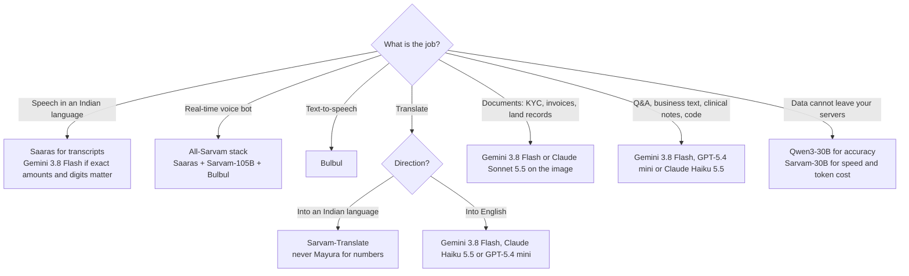
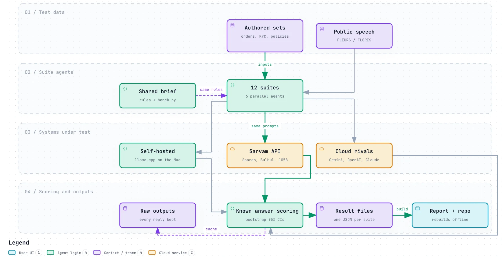
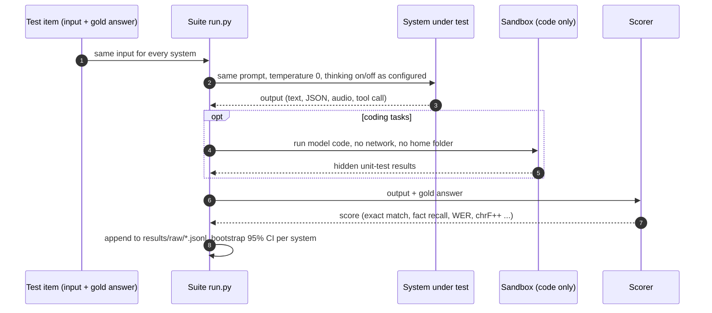

<h1 align="center">Sarvam Field Test</h1>

<p align="center">
An open, reproducible benchmark of <b>Sarvam AI</b> against <b>Google Gemini</b>, <b>OpenAI</b>, <b>Anthropic Claude</b> and
<b>self-hosted open weights</b> on fifteen jobs Indian businesses and developers actually do, three of them with spoken input.<br>
Every test has known answers, so scoring is automatic and no model grades another.
</p>

<p align="center">
<a href="report/index.html"><b>Interactive report</b></a> ·
<a href="#results-at-a-glance">Results</a> ·
<a href="#what-to-use-for-which-job">What to use</a> ·
<a href="#methodology">Methodology</a> ·
<a href="#biases-and-limitations">Biases</a> ·
<a href="#reproduce">Reproduce</a>
</p>

Run on 11 October 2026 on one Apple M5 Max (128 GB) in Kochi, India. Across **18** like-for-like head-to-heads,
Sarvam **leads 2**, is **level on 9** and is **behind on 7**.

> **In one line:** use Sarvam for Indian-language speech, voice bots and translating *into* Indian languages; for reasoning over
> text, documents and code, a price-matched Gemini, OpenAI or Claude model was more accurate in every test we ran.

The interactive report (`report/index.html`, open it in a browser) has every chart with confidence intervals, per-language
tables, worked examples and the source of every script.

---

## Results at a glance

Best Sarvam system against the best rival that ran on the **same full test set**. *Level* means the two 95% bootstrap
confidence intervals overlap or the scores are under 2% apart. Frontier models (Gemini Pro, GPT-5.5, Claude Sonnet 5.5) ran
on fixed 30-item subsets and are reported inside each suite rather than here.

| Test | Best Sarvam | Best rival | Result |
|---|---|---|---|
| [Hinglish support calls: numbers captured](#uc01-voice-support) | Saaras v3 codemix mode **81%** | Gemini 3.8 Flash **94%** | ▼ Sarvam behind |
| [Helpline speech in 13 languages: word error rate](#uc02-helpline-stt) | saaras:v4 transcribe mode **0.15** | Gemini 3.8 Flash **0.21** | ▲ Sarvam leads |
| [Documents from bad phone photos: fields right](#uc03-documents) | Sarvam Vision+Sarvam-105B **92%** | Claude Sonnet 5.5 **96%** | = Level |
| [Q&A over Indian-language policies: correct](#uc04-indic-rag) | Sarvam-105B · thinking **96%** | Gemini 3.8 Flash **100%** | ▼ Sarvam behind |
| [Clinical notes: drug + dose + frequency exact](#uc05-clinical-notes) | Sarvam-105B **92%** | Gemini 3.8 Flash **100%** | ▼ Sarvam behind |
| [Crop advisory (incl. refusing out-of-scope)](#uc06-offline-agri) | Sarvam-105B **90%** | Gemini Pro · thinking **100%** | = Level |
| [Translation into Indian languages (chrF++)](#uc07-translation-dubbing) | Sarvam-Translate **51.8** | Gemini 3.8 Flash **49.7** | = Level |
| [Translation into English (chrF++)](#uc07-translation-dubbing) | Sarvam-105B **57.8** | Gemini 3.8 Flash **64.3** | ▼ Sarvam behind |
| [Dubbing: time to first audio](#uc07-translation-dubbing) | Bulbul v3 **430 ms** | GPT-4o mini TTS **1.04 s** | ▲ Sarvam leads |
| [WhatsApp orders: whole order exactly right](#uc08-quick-commerce) | Sarvam-105B · thinking(16k cap) **91%** | Gemini 3.8 Flash **98%** | = Level |
| [Legal translation: facts kept](#uc09-legal) | Sarvam-105B **100%** | GPT-5.4 mini **100%** | = Level |
| [Legal summaries: key facts kept](#uc09-legal) | Sarvam-105B · thinking (empties rerun at 16k) **89%** | Gemini 3.8 Flash **98%** | ▼ Sarvam behind |
| [Business text tasks: fully correct](#uc10-selfhost-business) | Sarvam-105B **94%** | Gemini 3.8 Flash **100%** | ▼ Sarvam behind |
| [Coding Indian business logic: first try](#uc11-bharat-code) | Sarvam-105B · thinking-t0 **69%** | Gemini 3.8 Flash **100%** | ▼ Sarvam behind |
| [Voice-assistant tool calls: exact](#uc11-bharat-code) | Sarvam-105B **100%** | Gemini 3.8 Flash **100%** | = Level |
| [Spoken farmer questions: answered right (speech front end)](#uc06v-offline-agri-voice) | saaras:v4 -> Gemini 3.8 Flash [phone] **99%** | audio -> Gemini 3.8 Flash [phone] **100%** | = Level |
| [WhatsApp voice notes: order exactly right (speech front end)](#uc08v-voice-orders) | phone: saaras-v4 codemix mode-kt **92%** | phone: gemini-direct-audio **94%** | = Level |
| [Spoken payment commands: exact (speech front end)](#uc11v-voice-tools) | Saaras v3 -> Gemini 3.8 Flash **98%** | Gemini 3.8 Flash audio-direct **98%** | = Level |

## What to use for which job



- **Speech recognition in Indian languages:** Saaras v4 had the lowest average word error rate over 13 languages (0.149, against 0.21 for Gemini and 0.27 for OpenAI) and was the most accurate transcriber of spoken farmer questions. It often writes numbers as words, so for amounts and account digits on phone calls Gemini 3.8 Flash (94%) and Saaras v3 (81%) beat Saaras v4 with keyterms (56%). Add a number-words-to-digits step.
- **Spoken input in front of an app:** with the same Gemini model behind it, a Saaras front end matched Gemini's own audio input on spoken farm questions, voice-note orders and spoken payment commands, and beat OpenAI's transcriber in all three.
- **Real-time voice bot:** the all-Sarvam stack (Saaras v4, Sarvam-105B, Bulbul v4-flash) reached first audio in about 1.1 s, replied in the caller's language 18 of 20 times and cost about ₹1.42 per conversation-minute. The all-Gemini stack read numbers back more accurately but took about 6.8 s.
- **Text-to-speech:** Bulbul v3 was as intelligible as Gemini and OpenAI voices across 10 languages; Bulbul v4-flash starts about 50 ms sooner but was slightly less clear.
- **Translation:** Sarvam-Translate was best into Indian languages (8 of 10). Mayura garbled every decimal crore amount. Into English, Gemini, Claude and OpenAI were 6–12 chrF++ points ahead.
- **Documents:** clean scans were a tie (~99.5%). On bad phone photos Sarvam's legacy Vision pipeline invented text that was not on the page; the newer Document AI Extract invents less but was no more accurate; OpenAI models misread Indian-script names.
- **Chat, Q&A, clinical notes, code:** price-matched cloud models were more accurate. Sarvam-105B closes part of the gap with thinking on, at 5–46 s per answer, and sometimes returns nothing.
- **Self-hosting:** Qwen3-30B was more accurate than Sarvam-30B (84% vs 63% on business tasks); Sarvam-30B was faster and much cheaper to feed Indian text.
- **Token cost of Indian text:** Sarvam's tokenizer is cheapest (1.55x the English count), then Gemini (1.89x), OpenAI (2.10x), Claude (3.44x), Qwen3 (5.89x).

---

## Cost and intelligence

Accuracy is the average of seven text tests (policy Q&A, clinical medications, crop advice, WhatsApp orders, legal summaries,
business text, coding). Cost is measured: tokens each model actually used, thinking and repair attempts included, times
October 2026 list prices at ₹96.61/US$.

| Model | Average accuracy | API cost per 1,000 tasks |
|---|---|---|
| Gemini 3.8 Flash | 99% | ₹152 |
| Gemini Pro (subsets) | 99% | ₹1,713 |
| GPT-5.5 (subsets) | 99% | ₹1,340 |
| Claude Sonnet 5.5 (subsets) | 98% | ₹839 |
| GPT-5.4 mini | 91% | ₹139 |
| Claude Haiku 5.5 | 90% | ₹35 |
| Sarvam-105B · thinking | 83% | ₹293 |
| Sarvam-105B | 80% | ₹35 |
| Qwen3-30B (self-hosted) (subsets) | 72% | own hardware |
| Sarvam-30B (self-hosted) (subsets) | 51% | own hardware |

Claude Haiku 5.5 was the best value; Sarvam-105B cost about the same but was about 10 points less accurate; Gemini 3.8 Flash
bought the last 9 points for about 4x the cost. Gemini 3.8 Flash prices are promotional until 31 Dec 2026 and double after.

## Use-case map

| Job | Who needs it | Recommended | Evidence |
|---|---|---|---|
| EMI and collections reminder calls | Banks, NBFCs | All-Sarvam voice stack; confirm amounts with a Gemini 3.8 Flash transcript | [1](#uc01-voice-support) |
| Inbound support calls in regional languages | Telecom, D2C | Saaras → GPT-5.4 mini or Claude Haiku 5.5 → Bulbul | [1](#uc01-voice-support) |
| Citizen grievance and scheme helplines | Government | Saaras for transcripts; check Sindhi and Assamese separately | [2](#uc02-helpline-stt) |
| Call-centre QA and analytics | BPO, insurance | Saaras batch with speaker labels | [2](#uc02-helpline-stt) |
| KYC and account-opening documents | Banks, fintech | Gemini 3.8 Flash or Claude Sonnet 5.5 on the image; human review for poor photos | [3](#uc03-documents) |
| GST invoice capture | Accounts payable, SMEs | Gemini 3.8 Flash on the image; Sarvam Document AI on clean scans | [3](#uc03-documents) |
| Land-record digitisation | State governments | Gemini or Claude on the image; reject fields the model cannot read | [3](#uc03-documents) |
| HR and policy assistant in Indian languages | Enterprises | Gemini Embedding 2 retrieval + Gemini 3.8 Flash answers | [4](#uc04-indic-rag) |
| Insurance claim questions | Insurers, TPAs | Same RAG stack; test answers in the user's script | [4](#uc04-indic-rag) |
| OPD doctor scribe | Clinics, healthtech | Gemini 3.8 Flash straight on the consultation audio | [5](#uc05-clinical-notes) |
| Krishi advisory helpline | Agritech, FPOs | Cloud model that refuses out-of-scope questions; offline only with thinking on | [6](#uc06-offline-agri) |
| Course and training localisation | Edtech, L&D | Sarvam-Translate into Indian languages + Bulbul voice-over | [7](#uc07-translation-dubbing) |
| Product catalogue translation | E-commerce | Sarvam-Translate into Indian languages; Gemini into English | [7](#uc07-translation-dubbing) |
| WhatsApp orders and voice notes | Quick commerce, kirana | Gemini 3.8 Flash for order extraction; Saaras v4 + keyterms or Gemini audio for voice notes | [8](#uc08v-voice-orders) |
| Name and address transliteration | Logistics | Gemini 3.8 Flash; Sarvam's transliterate API is weak on Tamil | [8](#uc08-quick-commerce) |
| Judgment and order translation | Courts, legal-tech | Sarvam-105B or GPT-5.4 mini; never Mayura for amounts | [9](#uc09-legal) |
| Plain-language summaries for litigants | Legal aid | Gemini 3.8 Flash or GPT-5.4 mini | [9](#uc09-legal) |
| Ticket triage and CRM notes | SaaS support | GPT-5.4 mini or Claude Haiku 5.5 | [10](#uc10-selfhost-business) |
| On-premise processing of regulated data | Banks, hospitals | Qwen3-30B self-hosted; Sarvam-30B if speed and token cost matter more | [10](#uc10-selfhost-business) |
| Coding copilot for Indian business logic | Fintech, ERP vendors | Gemini 3.8 Flash or Claude Haiku 5.5 | [11](#uc11-bharat-code) |
| Voice-assistant actions (recharge, bill pay) | Wallets, telecom | Saaras or Gemini audio in front of Gemini tool calling; confirm payee and amount before paying | [11](#uc11v-voice-tools) |
| Budgeting Indian-text-heavy workloads | Any | Sarvam's tokenizer is cheapest; Claude uses 3.4× the English token count | [12](#uc12-token-tax) |

---

## Methodology

### How it ran

<picture>
  <source media="(prefers-color-scheme: dark)" srcset="docs/pipeline-dark.webp">
  
</picture>

Six parallel agents built and ran the suites, all sharing one library ([`common/bench.py`](common/bench.py)) for API clients,
scoring and result files. Every model output is kept, so every number can be audited and every rerun is resumable.

### How one test item is scored



### Systems tested

| Vendor | Systems | Access | Settings |
|---|---|---|---|
| Sarvam | Sarvam-105B, Sarvam-105B conversations, Saaras v3/v4 (STT), Bulbul v3/v4-flash (TTS), Sarvam-Translate, Mayura, Transliterate, Sarvam Vision / Document AI | Sarvam API | 105B with `reasoning_effort: null` (thinking off) and `medium` (on) |
| Sarvam (open weights) | Sarvam-30B, official Q4_K_M GGUF | llama.cpp on the test Mac | thinking off via an empty `<think></think>` prefill |
| Google | Gemini 3.8 Flash (and Flash TTS), Gemini Pro, Gemini Embedding 2 | Gemini API | Flash thinking off, on where it mattered |
| OpenAI | GPT-5.4 mini, GPT-5.5, gpt-4o-transcribe, whisper-1, gpt-4o-mini-tts | OpenAI API | `reasoning_effort` none / medium |
| Anthropic | Claude Haiku 5.5, Claude Sonnet 5.5 | OpenRouter | reasoning off / low (Sonnet cannot turn it off) |
| Open weights | Qwen3-30B-A3B Q4_K_M, Whisper large-v3-turbo | llama.cpp / transformers on the test Mac | `/no_think` |

Price-matched tier (Sarvam-105B, Gemini 3.8 Flash, GPT-5.4 mini, Claude Haiku 5.5) ran on every item. The frontier tier
(Gemini Pro, GPT-5.5, Claude Sonnet 5.5) ran on fixed subsets to show the ceiling.

### Test data

| Use case | Items | Source | Licence |
|---|---|---|---|
| [Code-mixed voice support & collections calls](#uc01-voice-support) | 80 | Authored for this benchmark | CC-BY-4.0 (this repo) |
| [Citizen helpline speech-to-text across India's languages](#uc02-helpline-stt) | 350 | Public | CC-BY-4.0 |
| [Documents: KYC, GST invoices, land records and bills in Indian scripts](#uc03-documents) | 60 | Authored for this benchmark | CC0 (synthetic); fonts are macOS system fonts used only to render images |
| [Q&A over company documents in Indian languages (RAG)](#uc04-indic-rag) | 132 | Authored for this benchmark | CC-BY-4.0 (this repo) |
| [Mixed-language doctor-patient consultation -> English clinical note](#uc05-clinical-notes) | 40 | Authored for this benchmark | CC-BY-4.0 (this repo) |
| [Offline crop advisory](#uc06-offline-agri) | 70 | Authored for this benchmark | CC-BY-4.0 (this repo) |
| [Spoken farmer questions (voice-in crop advisory)](#uc06v-offline-agri-voice) | 70 | Authored for this benchmark | CC-BY-4.0 (this repo) |
| [Translation and dubbing of training content / product copy](#uc07-translation-dubbing) | 32 | Public | CC-BY 4.0 |
| [Code-mixed quick-commerce orders and product/place-name transliteration](#uc08-quick-commerce) | 200 | Authored for this benchmark | CC-BY 4.0 |
| [WhatsApp voice-note orders: speech recognition in front of order extraction](#uc08v-voice-orders) | 86 | Authored for this benchmark | CC-BY 4.0 |
| [Courts and legal: translating and summarising judgments without losing facts](#uc09-legal) | 40 | Authored for this benchmark | CC0 (synthetic) |
| [Self-hosting Sarvam-30B for business text](#uc10-selfhost-business) | 150 | Authored for this benchmark | CC-BY-4.0 (this repo) |
| [Bharat Code: coding agents for Indian business logic, prompted in Indian languages](#uc11-bharat-code) | 160 | Authored for this benchmark | CC-BY-4.0 (authored here) |
| [Voice-in tool calling: spoken Indian-language payment commands](#uc11v-voice-tools) | 50 | Authored for this benchmark | CC-BY-4.0 |
| [The Indic token tax](#uc12-token-tax) | 100 | Public | CC-BY-4.0 |

Authored sets use fake people and IDs marked SAMPLE (valid checksum formats where a test needs them). Public data is FLEURS /
FLORES (CC-BY 4.0).

### Scoring and statistics

- **Known answers only.** Every item has a gold answer (number, code, label, fact list, reference text, unit tests) and is scored by code. No LLM-as-judge.
- **Speech and dubbing quality** use references (FLEURS) or round-trip transcription by two or three different vendors' transcribers, reported separately so a judge's home advantage is visible.
- **Uncertainty:** 95% bootstrap confidence intervals (2,000 resamples over items) on every score.
- **Head-to-head rule:** *level* if the intervals overlap or the gap is under 2%; otherwise lead or behind. Overlapping intervals is a conservative test: some *level* rows would separate under a paired test.
- **Like-for-like samples:** systems that ran on fewer than 80% of a metric's items are excluded from the scorecard and labelled with their sample size in charts.

### Fairness controls

- Identical inputs and prompts for every system; no per-vendor prompt tuning.
- Test audio was synthesised with Gemini TTS and macOS voices, **never with Sarvam's Bulbul**, so Saaras is not transcribing its sibling's voice.
- In voice-input variants, every transcript goes to the **same** downstream model, so differences come only from speech recognition.
- Keyterm lists for Saaras v4 are fixed and generic (product and brand terms), never the per-item answers.
- Thinking mode on and off reported separately; empty replies caused by the token budget are reported and also rerun with a larger budget.
- Model-written code runs only inside a macOS `sandbox-exec` profile: no network, no home-folder reads, no writes outside a temp folder, 10 s timeout.

---

## Biases and limitations

We tried to make this fair. These are the ways it may still not be, so you can weigh the results yourself.

- **Who built it.** The test sets, prompts, scorers and this README were written by AI agents running Anthropic's Claude, and Claude models are also contestants. We limited this by scoring only against known answers, but test items written by one model may suit that model family's style. Claude Haiku and Sonnet did not top the scorecard, which is weak evidence the effect is small.
- **What the requester expected.** The benchmark was commissioned with the hypothesis that Sarvam would win. We fixed the scoring rules before the runs and kept every output; where Sarvam loses, the outputs are in `results/raw/` to check.
- **Synthetic data.** Most test sets were written for this benchmark and **no native speaker reviewed them**. Phrasing may be unnatural in places, and gold answers in Indian languages could contain errors. Treat absolute scores as indicative; the comparisons are the result.
- **Synthetic speech.** Code-mixed calls, consultations and voice-input tests use text-to-speech, which is cleaner than real calls (no crosstalk, accents within one voice, no real phone codecs beyond our 8 kHz simulation). Gemini TTS voices may favour Gemini's own speech recognition; the voice suite checks this on macOS-voiced clips separately.
- **Geography and latency.** Runs were made from India. Sarvam's servers are in India; the other vendors' are likely further away, which favours Sarvam on latency. Accuracy is unaffected.
- **Model versions move.** Our first pass used Saaras v3 and Bulbul v3; Saaras v4 (25 Sep 2026), Bulbul v4-flash and Sarvam's Document AI Extract were added after we noticed them. Versions were checked against each API's model list on 11 October 2026. Rerun before relying on these numbers.
- **Self-hosted settings.** Only the official Q4_K_M quantisation of Sarvam-30B exists; we compared Qwen3-30B at the same quantisation. The test Mac was shared and often heavily loaded (load average up to 265), so local speed numbers are floors.
- **Thinking and temperature.** Temperature 0 throughout, except Sarvam-105B thinking runs at Sarvam's recommended 0.5. Gemini thinking ran at temperature 0 rather than Google's recommended 1.0, which may understate it slightly.
- **Scoring decisions made after seeing outputs.** Two were made and are disclosed in their suites: accepting native-script variants of four Bengali surnames (uc08), and stem/synonym and dose-format tolerance in clinical notes (uc05), applied to every system.
- **Saturation.** Several tests (business text, coding, legal translation) are near the ceiling for strong models, so they separate weak systems from strong ones but cannot rank the strongest.
- **Small subsets.** Frontier checks use 30-item subsets; local models in some suites ran on 8–50-item subsets because they were slow. Those numbers are indicative.

---

## How to read the metrics

| Metric | Meaning | Better |
|---|---|---|
| Accuracy / exact match | Share of items fully right against the gold answer | Higher |
| Fact recall | Share of gold facts present in a summary or note | Higher |
| Entity accuracy / preservation | Numbers, amounts, dates, section numbers, names carried over exactly | Higher |
| WER / CER | Word / character error rate of a transcript; 0.20 = one word in five wrong | Lower |
| chrF++ | Character and word n-gram overlap with a human translation, 0–100 | Higher |
| pass@1 / pass@3 | Coding tasks passing hidden unit tests first try / within three tries with failures fed back | Higher |
| Token tax | Tokens for a sentence in an Indian language ÷ tokens for the same English sentence | Lower |
| 95% CI | Bootstrap interval over items; overlapping intervals mean no clear winner | Narrower |

Every `results/<suite>.json` holds `metrics` (per-system `mean`, `lo`, `hi`, `n`), `per_language`, `speed` (p50/p95 ms),
`usage` (tokens, audio seconds, pages, characters), `examples`, `findings`, `caveats` and `verdict`.
`results/raw/<suite>.jsonl` has every model output with its score.

---

## Results by use case

### uc01-voice-support

#### 1. Code-mixed voice support & collections calls

> A bank, telecom or insurer handling Hinglish/Tanglish/Manglish/Benglish/Kanglish calls: which speech-to-text gets the caller's card digits, amounts, dates and phone numbers right, and which voice-agent stack answers fastest?

**Verdict.** For capturing what a collections or card-services call actually needs — the digits — use gemini-3.8-flash as the transcriber or add a number-normalisation step after Sarvam: Gemini got 94% of amounts, card digits, dates and phone numbers exactly; saaras:v3 codemix 74-81%; the newer saaras:v4 codemix only 39-46% because it spells numbers out as words (v4 transcribe 60-64%); gpt-4o-transcribe ~60%; hosted whisper-1 ~50%. If you adopt saaras:v4 for its cleaner code-mix text (lower WER, consistent Latin for English words), configure a keyterm list (it lifted phone-line entity accuracy from 0.39 to 0.56 and gave the lowest phone CER of any system) and still budget an inverse-text-normalisation step — without it, v4 is a regression for numeric data versus v3. For the full voice loop, Sarvam's stack is the fastest available: the v4 stack (saaras:v4 + sarvam-105b + bulbul:v4-flash) starts speaking in ~1.1 s p50 (v3 stack 1.5 s, OpenAI 3.2 s, Gemini 6.8 s), and sarvam-105b is the fastest reply LLM and the most reliable at answering in the caller's language. Do not use Whisper (local or hosted) for code-mixed Indian calls.

<details><summary>Findings, caveats and files</summary>

**Findings**

- Entity accuracy (what a bank needs: card last-4, amounts, dates, phone and claim numbers, 100 entities): gemini-3.8-flash 0.94 [0.89-0.98] on both clean and phone-line audio; saaras:v3 codemix 0.74 [0.65-0.83] clean / 0.81 [0.73-0.88] phone; gpt-4o-transcribe 0.61 / 0.57; whisper-1 (hosted Whisper) 0.50 / 0.51; saaras:v3 transcribe 0.43 / 0.46; local whisper-large-v3-turbo 0.24 / 0.26.
- saaras:v4 (released 25 Sep 2026) vs v3 on the same clips. Codemix mode: v4 follows the code-mix script convention almost always (1/160 outputs without Latin vs 48/160 for v3) and has lower WER on clean audio (0.27 [0.22-0.33] vs 0.38; phone tie 0.30), but it writes numbers as words far more often, so entity accuracy FALLS: 0.46 clean / 0.39 phone vs v3's 0.74 / 0.81. Numbers-as-words misses per 100 entities: v4 codemix 50 clean / 57 phone vs v3 15 / 11 (e.g. ml: '₹18,000' -> 'പതിനെണ്ണായിരം രൂപ'). Transcribe mode improves: v4 entity accuracy 0.60 / 0.64 vs v3 0.43 / 0.46, numbers-as-words 35 / 31 vs 51 / 52. Best-of-two-references WER: v4 transcribe 0.24 / 0.28 vs v3 0.39 / 0.43. Neither v4 mode reaches gemini-3.8-flash on digits (0.94).
- Keyterm prompting (saaras:v4 only; v3 rejects it with HTTP 400) with ONE fixed 50-term list a bank/telecom would configure once — UPI, EMI, KYC, IFSC, NEFT, OTP, PhonePe, Airtel, Jio, postpaid, recharge, claim number, premium… and no per-clip numbers — helps v4 codemix: entity accuracy 0.50 [0.41-0.60] clean / 0.56 [0.47-0.66] phone vs 0.46 / 0.39 without; numbers-as-words misses 45 / 39 vs 50 / 57; WER 0.25 / 0.23 vs 0.27 / 0.30 (phone CER 0.19, the best of any system); occurrences of 14 listed brand/product terms (UPI, EMI, OTP, Airtel, Jio, PhonePe…) written correctly in Latin: 93/106 vs 83/106. A repeat of plain v4 codemix on the phone audio scored 0.38, so the phone gain is not run-to-run noise; the clean gain is within noise. Even with keyterms, v4 codemix stays below v3 codemix (0.74 / 0.81) on digits. Gains are uneven by language: Manglish and Kanglish phone 0.45 -> 0.80 and 0.35 -> 0.70, Benglish unchanged (0.20 -> 0.15). Keyterm calls were slower: p50 1.78 s / p95 6.0 s.
- Inverse text normalisation (number words -> digits) was NOT implemented: a parser covering Hindi's 100 irregular number words plus agglutinated Tamil/Malayalam/Kannada/Bengali forms ('நானூற்றி எழுபத்தி ரெண்டு', 'പതിനെണ്ണായിരം') does not fit in ~60 lines. Upper bound instead, same rule for every system (count every miss whose output has no digits at all as recoverable, i.e. assume the spoken-out number is right): phone-line ceiling saaras:v4 codemix 0.96, v4+keyterms 0.95, v4 transcribe 0.95, v3 transcribe 0.98, v3 codemix 0.92, Gemini 0.94, gpt-4o-transcribe 0.71, whisper-1 0.85. So with perfect ITN the Sarvam v4 gap to Gemini could close, but that is a ceiling, not a measured result.
- saaras:v4 latency per utterance: p50 0.49-0.51 s (v3 0.61-0.65 s) but a heavier tail, p95 2.8-5.3 s vs ~0.9 s for v3, measured while other agents were rate-limiting the shared account.
- Most saaras misses are formatting, not hearing: in codemix mode 15 of 26 clean misses (11 of 19 phone) had no digits at all — the number came back as words (e.g. hi02 'बारह हज़ार चार सौ निन्यानवे', 'सेवन थ्री ज़ीरो सिक्स'). Codemix mode is not applied consistently: 48/160 codemix outputs contain no Latin letters at all, i.e. it fell back to transcribe-style output. Transcribe mode writes numbers as words almost always (51 of 57 misses). Add inverse text normalisation before using saaras output for account data.

**Caveats**

- Audio is synthetic (macOS `say` Indian voices for Hindi/Tamil/Bengali/Kannada, gemini-3.8-flash-tts for the rest and all Malayalam). TTS speech is cleaner and more regular than real callers; absolute error rates on real calls will be higher.
- Possible home advantage for Gemini on Gemini-voiced audio: on the 64 non-Malayalam clips per source, Gemini entity accuracy is 0.92 on `say` audio vs 0.97 on Gemini audio, but saaras codemix also improves (0.68 -> 0.81), so Gemini's lead holds on audio it did not generate.
- Gemini TTS read a style instruction aloud in 38 of 48 clips in the first synthesis pass; those clips were regenerated from the bare text and every STT result on them re-run. No clip was hand-checked by listening.
- References were written by one author; spellings of English loanwords in native script vary (யுபிஐ/யூபிஐ), which inflates every system's WER. That is why entity accuracy, not WER, is the headline.

- Data: uc01 code-mixed customer-care utterances (n=80; authored for this benchmark; licence CC-BY-4.0 (this repo))
- Code: [`suites/uc01_voice_support/`](suites/uc01_voice_support/) · results: [`results/uc01_voice_support.json`](results/uc01_voice_support.json) · every output: [`results/raw/uc01_voice_support.jsonl`](results/raw/uc01_voice_support.jsonl)

</details>

### uc02-helpline-stt

#### 2. Citizen helpline speech-to-text across India's languages

> A state or national citizen helpline takes calls in many Indian languages: which speech-to-text works in all of them, and how bad is its weakest language?

**Verdict.** For a multi-language citizen helpline, Sarvam's saaras is the strongest choice, and saaras:v4 is now the best version: lowest WER in 11 of the 13 comparable languages, macro WER 0.149 vs 0.170 for v3, 0.21 for Gemini and 0.27 for gpt-4o-transcribe, macro CER under half of Gemini's, every clip transcribed. Plan for its gaps: Sindhi only in Devanagari, a 30 s cap per REST call, and (in this run) a slower tail than v3 — keep v3 as a fallback if p95 latency matters. Gemini-3.8-flash and gpt-4o-transcribe are credible alternatives that also handle Arabic-script Sindhi; Gemini silently returned nothing for about 3% of clips. Whisper — hosted whisper-1 or local large-v3-turbo — is not fit for an Indian helpline.

<details><summary>Findings, caveats and files</summary>

**Findings**

- In the 13 languages where its output script matches FLEURS, saaras:v3 has the lowest WER in 12 (all except Urdu; Nepali 0.271 vs 0.272 and Telugu 0.170 vs 0.173 are ties; on CER Gemini wins Telugu, Marathi and Urdu): macro WER 0.17 / CER 0.052 vs gemini-3.8-flash 0.21 / 0.090, gpt-4o-transcribe 0.27 / 0.090, whisper-1 (hosted) 0.79 / 0.54 and whisper-large-v3-turbo (local) 0.75 / 0.45. Biggest saaras leads: Assamese 0.16 vs 0.31, Malayalam 0.17 vs 0.27, Punjabi 0.15 vs 0.23 (Gemini figures include its blocked clips).
- saaras:v4 transcribe improves on v3 on read speech: macro WER over the 13 comparable languages 0.149 [0.135-0.164] vs 0.170 [0.154-0.185], CER 0.044 vs 0.052; lowest WER of all systems in 11 of 13 languages (exceptions: Malayalam, where v3 is better, 0.167 vs 0.185, and Urdu, where Gemini is best). Worst comparable language Nepali 0.24 vs v3 0.27. Biggest gains: Telugu 0.17 -> 0.12 WER (CER 0.058 -> 0.017), Urdu 0.18 -> 0.14, Marathi 0.16 -> 0.13. Sindhi is still written in Devanagari only (25/25 clips), so Arabic-script Sindhi remains unavailable from Sarvam.
- saaras:v4 was slower per clip than v3 in this run: p50 1.9 s / p95 10.2 s (RTF 0.21) vs 0.87 / 2.3 s, measured under shared-account 429 pressure (4 of 350 calls needed a rerun after rate-limit backoff).
- Worst language: saaras Nepali 0.27 [0.22-0.33], Gemini Assamese 0.31 [0.21-0.42], Whisper Malayalam 1.00. Gemini's worst-language CI overlaps saaras's, so on read speech the two are close on the weakest language; Whisper is not.
- gpt-4o-transcribe is the most robust OpenAI option and the only system besides Gemini that writes every language, including Sindhi, in the reference script: WER worst language Nepali 0.42 [0.32-0.53], best CER of all systems on Tamil (0.091), zero blocked clips, p50 1.4 s (RTF 0.12). Its WER trails saaras in 12 of 13 comparable languages (it wins only Urdu, and on CER also Tamil); the gap is mostly word boundaries and spelling choices — its macro CER (0.090) equals Gemini's.
- Sindhi: saaras:v3 (language_code sd-IN) writes Sindhi in Devanagari, FLEURS uses Perso-Arabic script, so it scores WER 0.996 here. The Devanagari text reads as a faithful transcript (e.g. 'होस्टाइल माहौल वारे कोर्स…' for 'هوسٽائل ماحول واري ڪورس…'), so this is a script choice, not deafness — but a helpline that needs Arabic-script Sindhi cannot get it from saaras. Gemini handles Sindhi in Arabic script at WER 0.21.

**Caveats**

- FLEURS is read Wikipedia sentences recorded by volunteers on decent microphones: easier than real helpline calls (spontaneous speech, code-mixing, 8 kHz phone lines, background noise). Expect higher error rates in production, and see uc01 for phone-line and code-mixed results.
- 25 clips per language (first 25 distinct sentences <= 30 s in archive order); per-language CIs are wide (often +/-0.05 to +/-0.10 WER). Rankings between saaras and Gemini inside one language are often not significant; the macro averages and Whisper's failures are.
- Urdu is FLEURS ur_pk (Pakistani speakers) and Nepali is ne_np; Indian Urdu/Nepali speakers may differ.
- WER on Indic text is harsh: agglutinative words, optional nukta/halant spellings and number formatting all count as errors. CER is the fairer cross-language number; both are reported.

- Data: FLEURS (google/fleurs) test split (n=350; public; licence CC-BY-4.0)
- Code: [`suites/uc02_helpline_stt/`](suites/uc02_helpline_stt/) · results: [`results/uc02_helpline_stt.json`](results/uc02_helpline_stt.json) · every output: [`results/raw/uc02_helpline_stt.jsonl`](results/raw/uc02_helpline_stt.jsonl)

</details>

### uc03-documents

#### 3. Documents: KYC, GST invoices, land records and bills in Indian scripts

> Can I digitise Indian-language business documents (GST invoices, KYC forms, land records, utility bills, ration cards) into correct structured fields, from clean scans and from phone photos, and which stack should I use?

**Verdict.** For clean scans and ordinary phone photos of Indian-script business documents, any of these stacks reads about 99.5% of fields correctly. Choose on cost, latency and where the data may go. The all-Sarvam pipeline (Vision plus sarvam-105b) costs about ₹0.52 per page and runs on an Indian provider. Gemini on the image is faster at p95 (8.7 s vs 33.5 s) and simpler, since it needs no job API. Poor photos are the exception. There, Gemini on the image was clearly more robust (93% of fields and 56% of pages fully right, against 86% and 25%), and Sarvam Vision sometimes wrote fluent text that was not on the page, occasionally in the wrong script. So if your intake is mostly phone photos taken by customers or field staff, use Gemini, or put an image-quality gate and a re-capture step in front of Sarvam Vision. With either stack, validate IDs such as PAN and GSTIN by format and checksum. Among the added comparators, claude-sonnet-5.5 was the most accurate on bad photos, and claude-haiku-5.5 matched the leaders on clean and normal photos at about $0.37 per 1,000 pages. OpenAI's gpt-5.4-mini and gpt-5.5 misread or invented Indic-script values far more often in this test, so don't use them for this job without validation. Sarvam's newer Document AI Extract (Vision 1.5) was no more accurate than the legacy Digitization + sarvam-105b pipeline on these pages, and it still invents some values on bad photos, with high confidence. It is, however, simpler to call and has a much tighter latency tail (p95 8.8 s vs 33.5 s), at about twice the price (₹1 vs ₹0.52 per page).

<details><summary>Findings, caveats and files</summary>

**Findings**

- API version: every 'sarvam-vision' result here uses the legacy Document Digitization job API (/doc-digitization/job/v1, OCR to markdown), which Sarvam has marked legacy since 18 Aug 2026. The newer Document AI Extract (/doc-ai/v1/job/extract, Sarvam Vision 1.5, field schema in and JSON out in one job) is reported separately as 'sarvam-docai-extract'. It ran on the 30-page frontier subset (16 harsh + 14 phone photos) plus the clean render of the same 30 pages: 60 images at ₹1 per page.
- Clean scans and ordinary phone photos are essentially solved by all three stacks. Field exact-match: clean 99.5% (Sarvam Vision + sarvam-105b), 99.5% (Sarvam Vision + Gemini), 99.6% (Gemini on the image). Phone photo: 99.3% / 99.5% / 99.3%. The CIs overlap completely (60 pages, 783 fields each). Pages with every field correct: 93-95% clean, 92-93% photo.
- Bad photos separate the stacks. On the 16-page harsh subset (6 deg tilt, strong skew, hand shadow, noise, 0.55x resolution, JPEG q 22-30), Gemini on the image kept 92.8% of fields [87.2, 97.2] and got 56% of pages fully right. The Sarvam pipeline kept 85.6% [78.5, 92.1] and 25% of pages. Swapping sarvam-105b for Gemini as the extractor on the same Vision text only moved this to 86.5%, so the gap is OCR, not extraction.
- Text accuracy tells the same story. Order-free CER for Sarvam Vision vs Gemini OCR is 0.020 vs 0.023 clean and 0.015 vs 0.004 photo, then 0.193 vs 0.028 on harsh photos (gold-word recall 0.84 vs 0.95). The harsh-photo CER by script for Vision is worst in Tamil (0.32), Bengali (0.21) and Devanagari (0.20).
- On degraded pages Sarvam Vision writes fluent text that is not on the page. The Tamil patta header 'மாதிரி ஆவணம்' (sample document) came out as 'எதிரி ஆயுதம் - தற்காப்பு' (enemy weapon - defence). A line of Kannada about Belagavi district appeared inside the Tamil page. The 7/12 subtitle '(पिकांची नोंदवही)' became '(पिंपरी चिंचवड)', a real Pune place name, and sarvam-105b then put that into the taluka field. During the smoke test, a Kannada line on a mixed-script page also came back in Bengali script.
- Handwriting-style PANs expose character confusions. Sarvam Vision misread I/1 and O/0 in 3 of 10 KYC forms (e.g. FADPQ1032L read as FADPQI032L, HLOPM1790W as HLOPM179OW), the same way on clean and photo pages. Gemini got 1 of 10 wrong. A PAN or GSTIN format and checksum check would catch these, whichever OCR you use.

**Caveats**

- The documents are synthetic, computer-rendered pages with system fonts. There are no real stamps, signatures, carbon copies, printer artefacts, folds or Indic handwriting; the 'handwriting' is a Latin handwriting-style font, used only for KYC entries. Real scans will score lower than the clean condition here.
- The harsh condition covers only 16 pages (kept small to stay inside the Sarvam budget), so its CIs are wide. The direction is clear (Gemini better on every text metric), but the size of the field-accuracy gap is uncertain.
- Each Sarvam Vision job was given the page's correct language code. A production pipeline has to detect it first.
- There is one extraction prompt, shared by all systems, and Gemini ran with thinking off. Exact match is strict: names must stay in the printed script, while numbers compare by value and Indic digits are folded to ASCII.

- Data: uc03-synthetic-indic-docs (n=60; authored for this benchmark; licence CC0 (synthetic); fonts are macOS system fonts used only to render images)
- Code: [`suites/uc03_documents/`](suites/uc03_documents/) · results: [`results/uc03_documents.json`](results/uc03_documents.json) · every output: [`results/raw/uc03_documents.jsonl`](results/raw/uc03_documents.jsonl)

</details>

### uc04-indic-rag

#### 4. Q&A over company documents in Indian languages (RAG)

> Employees and customers ask questions (in their own language, in English, or in romanised WhatsApp-style text) over company documents written in Indian languages. Which model answers correctly, in the user's language, and says 'not in the documents' instead of guessing?

**Verdict.** For an Indian-language document help-desk, retrieval with gemini-embedding-2 is solved at this scale. Pick the generator for instruction-following. gemini-3.8-flash is the best default in the price-matched tier: 100% correct, 95% English replies to English questions, but only 62% romanised replies to romanised questions. sarvam-105b is fast (0.6 s) and cheap, and nearly always finds the right figure. With thinking off, though, it marks a third of its correct answers as not found and answers English questions in the document's language, so run it with reasoning on (0.96 correct, 3% false refusals, about 5 s) or don't use a refusal tag. Skip sarvam-105b-conversations for this task. gpt-5.4-mini is accurate but almost never answers in the user's language. If users write romanised or English text against Indic documents and language matching matters, only the frontier models (gemini-pro-latest, gpt-5.5, claude-sonnet-5.5) got it right every time on our subset. Whatever the model, scope retrieval to the right organisation: almost every model will quote another company's policy if retrieval hands it one. For on-premise use, qwen3-30b-local reads Indic documents well but over-answers when the documents don't contain the answer and overflows an 8k context on Kannada. sarvam-30b-local tokenizes Indic text efficiently but needs work on its refusal behaviour before it is usable.

<details><summary>Findings, caveats and files</summary>

**Findings**

- Retrieval was not the bottleneck. gemini-embedding-2 put the gold chunk in the top 5 for 108/108 answerable questions (recall@1 0.98), the same for native-script, English and romanised questions. Cross-script search works with the task written into the text (gemini-embedding-2 has no task_type). The corpus is small, though: 39 chunks, each document in a different language.
- Answer correctness on the full 108 answerable questions (top-5 retrieval): gemini-3.8-flash 1.00, gpt-5.4-mini 0.99, sarvam-105b with thinking 0.96, claude-haiku-5.5 0.94, sarvam-105b with thinking off 0.67, sarvam-105b-conversations 0.52. On the 30-question frontier subset: gemini-pro-latest 1.00, gpt-5.5 0.97, claude-sonnet-5.5 0.97.
- sarvam-105b with thinking off finds the right number almost every time (gold value present in 98% of replies, 96% for -conversations). It then appends the [NOT_FOUND] tag to 32% of correct answers (47% for -conversations), apparently because some of the 5 excerpts come from other documents. One reply says the answer is in the Periyar bank document, then tags it as not found because it is absent from the Surma Telecom excerpt. A bot that routes on the tag would hide about a third of correct answers. With reasoning on, false refusals fall to 3% and correctness rises to 0.96, at about 8x the latency (p50 4.9 s vs 0.6 s) and 220k reasoning tokens for 240 calls.
- The oracle condition gives the gold chunk alone, and sarvam-105b with thinking off still scores 0.62. Its errors come from generation and instruction-following, not retrieval. The other systems score the same with or without retrieval.
- Replying in the user's language is the biggest gap. For native-script questions every system replies in that script (98-100%). For English questions about an Indic document, most models answer in the document's language. Share of English questions answered in English: gpt-5.4-mini 0.07, sarvam-105b 0.11, sarvam-105b-conversations 0.17, claude-haiku-5.5 0.33, sarvam-105b with thinking 0.88, gemini-3.8-flash 0.95, all three frontier models 1.00.
- Self-hosted models (llama.cpp Q4_K_M, thinking off, all 132 questions, rag condition): qwen3-30b-local answered 0.94 of the 108 answerable questions correctly, but refused only 0.62 of the unanswerable ones and replied in Latin script to 0 of 38 romanised questions. sarvam-30b-local found the gold value in 0.85 of replies, but appended [NOT_FOUND] to 64% of answerable questions (correct 0.30). It answered English questions in English only 5% of the time, refused 0.79 of the unanswerable questions, and is the only system that invented numbers (2 of 132 replies; for example, it made up a ₹1,500 ambulance charge for an unanswerable Kanglish question). sarvam-30b-local is not usable for this task without heavy prompt or format work.

**Caveats**

- The data is synthetic: 6 documents and 132 questions written by an LLM author (Claude). Each gold answer was checked by machine against its chunk, but no native speaker has reviewed the language quality.
- The task is easy for strong models (several score 1.00), so the differences between systems are about instruction-following (the [NOT_FOUND] tag, reply language) more than reading comprehension. Harder multi-hop or arithmetic questions were deliberately left out.
- The [NOT_FOUND] tag is our prompt's way to detect refusals. A system that answers correctly and still adds the tag is scored as refusing, because a bot routing on the tag would treat it that way. The lenient metric gold_present_ignoring_tag_rag ignores the tag.
- The reply-language check uses the dominant script, so a romanised question expects a Latin-script reply. A native-script reply to a romanised question may be acceptable to some users.

- Data: uc04 synthetic Indian-language policy documents (n=132; authored for this benchmark; licence CC-BY-4.0 (this repo))
- Code: [`suites/uc04_indic_rag/`](suites/uc04_indic_rag/) · results: [`results/uc04_indic_rag.json`](results/uc04_indic_rag.json) · every output: [`results/raw/uc04_indic_rag.jsonl`](results/raw/uc04_indic_rag.jsonl)

</details>

### uc05-clinical-notes

#### 5. Mixed-language doctor-patient consultation -> English clinical note

> A clinic records an outpatient consultation held in Hinglish / Malayalam-English / Tamil-English / Bengali-English / Marathi-English. Which model turns it into a correct structured English note, and which one invents medicines or doses (the safety risk)?

**Verdict.** For an AI scribe working from a transcript, gemini-3.8-flash (thinking off) is the pick in the price-matched tier: perfect on every field we scored, no invented drugs, 4 s per note. gpt-5.4-mini (1.5 s) is a close, faster second. sarvam-105b is as safe (it never invented a medicine) and fast (1.8 s), but it gets about 1 in 15 frequencies wrong, typically turning an as-needed dose into a scheduled one. Reasoning mode does not fix that and makes it 14x slower, so any Sarvam-based scribe needs a frequency check by the doctor. From audio, sending the recording straight to gemini-3.8-flash was the most accurate path in our test (100% on 15 dialogues). The Sarvam pipeline is cheap (₹45/hour of audio with diarization) and diarizes correctly. Use saaras:v4 in codemix mode, then sarvam-105b: on 15 dialogues it scored 0.97 fact recall vs 0.94 for v3 translate, and it fixes v3's spoken-number errors. But every saaras version dropped the same prescription sentence in one Malayalam consultation, and medication exactness stays at 0.83 vs 1.00 for Gemini on the raw audio, so always show the doctor the transcript next to the note. Self-hosted 30B models are not ready to be an unsupervised scribe: about 1 in 5 medicine lines have an error, and 30-40% of notes are not fully in English. qwen3-30b-local was the safer of the two.

<details><summary>Findings, caveats and files</summary>

**Findings**

- From the dialogue text, every cloud model wrote a usable English note. fact_recall_overall over 40 dialogues: gemini-3.8-flash 1.00, gemini-pro-latest 1.00, claude-sonnet-5.5 1.00, gemini-3.8-flash with thinking, gpt-5.4-mini with thinking, claude-haiku-5.5 with thinking and gpt-5.5 all 0.99, sarvam-105b with thinking 0.98, gpt-5.4-mini 0.97, sarvam-105b 0.96 (CI 0.94-0.98), claude-haiku-5.5 without thinking 0.93.
- Safety metric: no text-track system listed a drug that was not prescribed or a dose that was never said (hallucinated meds/doses per note = 0.00 for all, n=30-40). All 40 traps were handled: refused antibiotics, stopped drugs, self-medication, mid-sentence dose corrections and late-disclosed allergies. With an explicit 'final prescription only' instruction, these models do not invent medicines.
- The errors that remain are frequency errors, and they are clinically meaningful. 'Paracetamol 5 ml only when fever is above 100, not more than 4 times a day' (an as-needed/SOS dose with a daily cap) was written as scheduled QID or TDS by sarvam-105b (d03, d13), sarvam-105b with thinking (d03, d19, d27, d28), claude-haiku-5.5 (d03, d13, d19, d27, d28), gpt-5.4-mini (d27) and the gpt-4o-transcribe pipeline. sarvam-105b also turned two 'morning one, night one' (BD) prescriptions into OD (d28 cefixime, d31 calcium). Medication exactness (drug + dose + frequency): gemini-3.8-flash 1.00, claude-haiku-5.5 with thinking 1.00, all frontier models 1.00, gpt-5.4-mini 0.99, sarvam-105b 0.93, sarvam-105b with thinking 0.91, claude-haiku-5.5 without thinking 0.90.
- Writing the note in English is not automatic. Share of notes with no Indic-script text: sarvam-105b, gemini (all modes), the frontier models and all audio pipelines 1.00, gpt-5.4-mini 0.95, claude-haiku-5.5 0.60 (0.90 with thinking), qwen3-30b-local 0.68, sarvam-30b-local 0.58. Claude Haiku and the local models often copied the patient's words in Hindi, Tamil or Bengali into the complaint or red-flag fields, e.g. 'बुखार, पूरे बदन में दर्द…' as the chief complaint.
- Self-hosted models (Q4_K_M, thinking off, all 40 dialogues), fact recall / medication exactness: qwen3-30b-local 0.79 / 0.87 with 0 invented medicines; sarvam-30b-local 0.78 / 0.79 with one invented medicine (d25: it listed 'Dolo 650' as a second drug next to paracetamol, which could lead to a double paracetamol dose). Neither listed a trap drug as prescribed. Most of their recall loss is complaint and red-flag text left in the source language; vitals recall stays at 0.95-0.97. p50 is 12 s per note on the shared Mac.
- Thinking did not help sarvam-105b here: medication exactness 0.91 with thinking vs 0.93 without. It cost 173k reasoning tokens for 40 notes, latency rose from 1.8 s to 25.8 s (p50), one note was not valid JSON (d37), and one omitted metformin after a mid-sentence dose correction (d18). For claude-haiku-5.5 and gpt-5.4-mini, thinking did help (0.90 to 1.00, and 0.97 to 0.99 fact recall).

**Caveats**

- The 40 dialogues and gold facts are synthetic, written by an LLM author (Claude). They are clean and well-structured compared with real OPD talk: no crosstalk, no background noise, every vital stated clearly. The task is near the ceiling for strong models.
- The audio is TTS (2 studio voices, no noise, no overlap), so the STT and audio results are optimistic compared with a real clinic recording. Recorded consultations with consent would be the next step.
- Free-text fields (complaint, diagnosis, red flags, follow-up) are scored by alias word overlap with a small synonym map. Correct paraphrases can still be marked as misses, so absolute red-flag recall is understated. All systems are scored with the same matcher, and we audited the misses by hand.
- The 'hallucinated dose' check only catches dose numbers that never appear in the dialogue. A real but wrong dose taken from elsewhere in the conversation shows up as a medication-exactness error instead.

- Data: uc05 synthetic OPD consultations (n=40; authored for this benchmark; licence CC-BY-4.0 (this repo))
- Code: [`suites/uc05_clinical_notes/`](suites/uc05_clinical_notes/) · results: [`results/uc05_clinical_notes.json`](results/uc05_clinical_notes.json) · every output: [`results/raw/uc05_clinical_notes.jsonl`](results/raw/uc05_clinical_notes.jsonl)

</details>

### uc06-offline-agri

#### 6. Offline crop advisory

> Can an open-weight model running on a local box (no internet, possibly no GPU) answer farmers' questions correctly from an advisory sheet, in their own language and script?

**Verdict.** Neither open-weight 30B model is safe as an unsupervised offline crop advisor in this setup. With thinking off, they give the right numbers for only ~70% of sheet questions and, worse, invent answers to most questions the sheet does not cover. Thinking on stops most of the invention but takes minutes per answer on shared hardware and produces more wrong-language replies. The two models tie on accuracy. Sarvam-30B replies in the farmer's language more reliably and processes Indic prompts with fewer tokens, so prefer it if you must go offline, behind a retrieval or whitelist layer and code checks that every number in an answer appears in the sheet. If there is any connectivity, use gemini-3.8-flash (100% grounded, no inventions) or sarvam-105b (95% grounded, 100% correct language, sub-second, ~₹0.02 per answer). The frontier models are perfect on the subset. Avoid gpt-5.4-mini and claude-haiku-5.5 for this job: they don't invent answers, but they refuse a quarter of answerable farmer questions.

<details><summary>Findings, caveats and files</summary>

**Findings**

- Grounded correctness on the 60 in-scope questions (answer contains every gold number from the sheet): gemini-3.8-flash 100%, sarvam-105b 95% [90,100]. Every offline variant lands at 68-77% with overlapping CIs: Sarvam-30B 73% (without thinking, with thinking, and on CPU alike), Qwen3-30B-A3B 68% without thinking, 77% with, 73% on CPU.
- The big offline risk is invented answers. Without thinking, Sarvam-30B refuses only 1 of 10 out-of-scope questions (3/10 if a helpline redirect without the code counts) and Qwen3 refuses 0/10 (4/10 lenient). Examples: Sarvam told a Tamil farmer to use 150 kg DAP per acre on tomato, and Qwen3 told a Marathi farmer that soybean is ₹1,800 per quintal today. Neither appears in the sheet.
- Cloud comparators (ADDENDUM). Cloud models do NOT invent answers to out-of-scope questions: gpt-5.4-mini, claude-haiku-5.5, gemini-pro-latest, gpt-5.5 and claude-sonnet-5.5 all refused 10/10. But the cheap ones over-refuse real sheet questions: gpt-5.4-mini answered 'NOT_IN_SHEET' to 23% of in-scope questions and claude-haiku-5.5 to 27%. This happened mostly on romanised or farmer-vocabulary phrasings (e.g. 'kandu jigihulu' for brown planthopper, 'ਨਰਮਾ' for cotton). As a result their grounded correctness, 75% and 70%, is no better than the offline 30B models. gpt-5.4-mini also mixes English into native-script replies ('40 kg प्रति acre'), so only 79% of its replies are in the farmer's language. On the fixed 30-question subset (all 10 out-of-scope + 20 in-scope), all three frontier models pass 30/30. On the same subset gemini-3.8-flash passes 93% and sarvam-105b 90%. gpt-5.4-mini and claude-haiku-5.5 pass 70%. Offline: Sarvam-30B 50% and Qwen3 40% without thinking; 60% each with thinking.
- Thinking fixes most of the invention (out-of-scope refusal: Sarvam-30B 100%, Qwen3 90%) but costs a lot. Sarvam-30B produced 1,577 output tokens per answer (p50 198 s on the shared GPU). False refusals rise to 13% (Sarvam) and 8% (Qwen3). Sarvam-30B's correct-language replies fall from 96% to 76%.
- Replying in the farmer's language and script, without thinking: Sarvam-30B 96% [90,100], Qwen3 90% [81,97], sarvam-105b 100%, Gemini 96%. Romanised questions are harder for every offline model: Sarvam-30B 67% grounded (native 80%), Qwen3 57% (native 80%). Several replies switched to native script or to English.
- Offline accuracy depends heavily on language. Overall pass, Sarvam-30B no-think: Hindi 83%, Marathi 83%, Tamil 82%, Kannada 58%, Punjabi 36%, Telugu 33%. sarvam-105b on the same questions: 100/100/100/92/91/75%.

**Caveats**

- One synthetic sheet and 70 hand-written questions (not native-reviewed). CIs are about ±10 points; per-language cells have 10-12 items.
- 'Grounded correct' checks that the gold numbers are present. It cannot catch a correct number attached to the wrong crop or unit, so it is an upper bound.
- The strict out-of-scope metric requires the NOT_IN_SHEET code. The lenient variant also accepts a KVK/helpline redirect; both are reported.
- The CPU and GPU runs used a shared Mac under heavy load (load average 15-560), so latencies are pessimistic. CPU answers ran one at a time with llama.cpp's prompt cache, which is how a single kiosk would behave.

- Data: uc06 advisory sheet + farmer questions (n=70; authored for this benchmark; licence CC-BY-4.0 (this repo))
- Code: [`suites/uc06_offline_agri/`](suites/uc06_offline_agri/) · results: [`results/uc06_offline_agri.json`](results/uc06_offline_agri.json) · every output: [`results/raw/uc06_offline_agri.jsonl`](results/raw/uc06_offline_agri.jsonl)

</details>

### uc06v-offline-agri-voice

#### 7. Spoken farmer questions (voice-in crop advisory)

> When farmers ask by voice (clean or over a phone line), how much does speech recognition cost the crop-advisory answer, and which STT front-end should a voice advisory line use?

**Verdict.** For a voice crop-advisory line in these six languages, put Sarvam's STT in front: saaras:v4 (or v3) transcribes 3-5x more accurately than gemini-3.8-flash or gpt-4o-transcribe, holds up on phone audio, and keeps downstream answers at 97-100%. If the answering model is Gemini anyway, sending it the audio directly is as good on these clips (100%) and saves the STT hop. Avoid gpt-4o-transcribe on phone audio for Punjabi, Kannada and Tamil: it garbles crop names, which turns into refusals or advice for the wrong crop. An all-Sarvam stack (saaras:v4 -> sarvam-105b) works (97-98% grounded, never invents answers) but needs a code check, because it often skips the machine-readable refusal code.

<details><summary>Findings, caveats and files</summary>

**Findings**

- Character error rate vs the spoken question (140 clips each, clean / phone line): saaras:v4 1.3% / 1.5%, saaras:v3 1.6% / 2.3%, gpt-4o-transcribe 4.7% / 8.5%, gemini-3.8-flash 5.2% / 6.8%. Sarvam's STT is 3-5x more accurate on these six languages, and the phone line barely hurts it. gpt-4o-transcribe degrades most on the phone line (Punjabi 12.4%, Kannada 10.6%), and Gemini on Tamil (10.3% / 18.9%).
- With the answering model held fixed (gemini-3.8-flash, thinking off), STT quality shows up in the advice. Overall pass on 70 questions: text oracle 100%; saaras:v3 100% / 97%; saaras:v4 99% / 99%; gemini STT 97% / 94%; gpt-4o-transcribe 99% / 90% (clean / phone). The damaging errors are crop names. Over the phone, gpt-4o-transcribe heard ਕਣਕ (wheat) as ਗੰਢ, பருத்தி (cotton) as பரிசி and ಹತ್ತಿ (cotton) as ಹಸಿಗೆ, and dropped soybean. The answering model then refused or answered for the wrong crop. Gemini still refused every out-of-scope question with every STT.
- Gemini answering straight from the audio, with no separate STT step, scored 100% / 100%. On these clips that is better than any transcript-based Gemini pipeline, and it saves a hop.
- All-Sarvam pipeline (saaras:v4 -> sarvam-105b): 97% / 98% grounded and 100% correct reply language. Strictly scored it passes 93% overall, because sarvam-105b often declines out-of-scope questions without the NOT_IN_SHEET code: 7/10 clean and 6/10 phone use the code, but 10/10 redirect to the KVK helpline (lenient). It never invents an answer.
- Spend: Sarvam ₹12.45 at list price (saaras v4 + v3 at ₹4.55 each for 9.1 min of audio; sarvam-105b answering ₹3.35). Gemini: 1.13M input / 31k output tokens for answering, mostly the advisory sheet repeated in the prompt. OpenAI: 140 gpt-4o-transcribe calls on 9.1 min of audio.

**Caveats**

- The speech is synthetic: macOS voices (Lekha hi, Soumya kn, Geeta te, Vani ta) and gemini-3.8-flash-tts voices reading clean text. Real farmers bring dialects, code-mixing, hesitations and field noise, so every CER here is optimistic, and the gap between STT systems on real calls could be larger or smaller.
- Gemini TTS produced the gemini-voiced clips, so Gemini STT and audio-in may have a home advantage on them. Even so, Gemini STT was the worst on the macOS-voiced clips (10.8% CER) and better on its own voices (3.5%), while saaras:v4 was 1.7% and 1.3%.
- A spoken question has no script, so the reply is expected in native script for every item, romanised ones included. Romanised items are spoken from their native-script twin by a different (gemini) voice. The 4 out-of-scope questions that existed only romanised were given hand-written native versions.
- The language code is passed to every STT system (as a voice line routed by IVR language menu would). Auto-detect was not tested.

- Data: uc06 questions, synthesised speech (n=70; authored for this benchmark; licence CC-BY-4.0 (this repo))
- Code: [`suites/uc06v_offline_agri_voice/`](suites/uc06v_offline_agri_voice/) · results: [`results/uc06v_offline_agri_voice.json`](results/uc06v_offline_agri_voice.json) · every output: [`results/raw/uc06v_offline_agri_voice.jsonl`](results/raw/uc06v_offline_agri_voice.jsonl)

</details>

### uc07-translation-dubbing

#### 8. Translation and dubbing of training content / product copy

> Localising training content and product copy into Indian languages, then dubbing it: which translation system and which TTS should an Indian business use?

**Verdict.** For localising formal English content into Indian languages, use sarvam-translate:v1. It was the most accurate system into Indian languages in 8 of 10 languages, and on a small subset no frontier model (gemini-pro, gpt-5.5, claude-sonnet-5.5) did better. Its lead over mayura:v1 and gemini-3.8-flash is only about 2 chrF, and it costs about 80x more per item than prompting sarvam-105b, so high-volume, lower-stakes copy can go through 105b or a price-matched model. For Indian languages into English (customer feedback, regional documents), use gemini-3.8-flash or claude-haiku-5.5. They lead sarvam-translate by 10-12 chrF, and sarvam-translate makes meaning-changing errors in that direction. Use mayura's colloquial mode only when you want code-mixed copy. For dubbing, bulbul:v3, gemini-3.8-flash-tts and gpt-4o-mini-tts are all intelligible in all 10 languages, with bulbul and Gemini slightly ahead. Bulbul starts playback about 3x sooner (357 ms) and has a simple per-character rupee price, so it is the best default for interactive voice and a fine choice for batch voice-overs. bulbul:v4-flash cuts about 50 ms off the median time to first audio (and about 190 ms at p95) but was slightly less intelligible on every judge, so prefer v3 for voice-overs and consider v4-flash only where the lowest latency matters most. The self-hosted 30B models are not ready for production translation into Indian languages.

<details><summary>Findings, caveats and files</summary>

**Findings**

- English->Indic, full set (320 items per system): sarvam-translate:v1 has the highest chrF++, 51.8 [50.1-53.5]. Next are mayura:v1 49.8, gemini-3.8-flash 49.7, claude-haiku-5.5 47.8, gpt-5.4-mini 46.6 and sarvam-105b 45.6. sarvam-translate is best of these systems in 8 of 10 languages (Gemini wins Kannada, Haiku wins Malayalam).
- Frontier models do not beat sarvam-translate into Indian languages. On the 30 sentence-language pairs where every system ran, sarvam-translate scores 53.5 against gemini-pro-latest 51.9, gemini-3.8-flash 51.9, gpt-5.5 51.0 and claude-sonnet-5.5 51.0, all with thinking on. The CIs (about +/-5 points at n=30) overlap, so the honest reading is 'no better', not 'worse'.
- Indic->English ranks the other way round: gemini-3.8-flash 64.3 [62.5-66.2], claude-haiku-5.5 62.1, gpt-5.4-mini 60.4, sarvam-105b 57.8, mayura 54.6, sarvam-translate:v1 52.5. On the 30-pair frontier subset, claude-sonnet-5.5 scores 65.9, about level with gemini-3.8-flash at 62.8. sarvam-translate's errors into English change the meaning. Hindi 'fabric ... shrinkage, or scorch' became 'clothing ... could lead to hypothermia or even burns', and Tamil 'appeared in court with covered faces' became 'was present in the court in the dock'.
- Cost differs by about 80x for similar volume. sarvam-105b translated all 640 items for about INR 1.4 in tokens (34.5k in, 15.3k out). sarvam-translate and mayura each cost about INR 115 at INR 20 per 10k input chars (57.8k chars). claude-haiku-5.5 cost US$0.029 for the same 640 items, as reported by OpenRouter.
- mayura:v1 modern-colloquial mode produces Hinglish/Tanglish copy: 61% of output letters are Latin, e.g. 'Fabric ரொம்ப hot ஆகாம பாத்துக்கோங்க'. Against the formal reference it scores chrF++ 16 vs 49 for formal mode. That is a deliberate change of register, not an error, and suits chat or marketing copy rather than formal training material.
- Dubbing intelligibility (26 sentences x 6 languages per TTS, three STT judges): bulbul:v3 and gemini-3.8-flash-tts are statistically tied, and gpt-4o-mini-tts is slightly behind. CER with saaras:v3 as judge: bulbul 1.8%, Gemini 1.9%, OpenAI 2.4%. With the vendor-neutral gpt-4o-transcribe as judge: Gemini 3.5%, bulbul 4.3%, OpenAI 5.0%, CIs overlapping. With Gemini as judge, counting its refusals as failures: Gemini 5.9%, OpenAI 6.7%, bulbul 7.3%. Without the refusals those three are 2.8%, 2.3% and 2.3%.

**Caveats**

- chrF++ uses a single human reference per sentence. A correct paraphrase loses points, so differences under about 2 points on the full set, or about 5 points on 30-item subsets, are noise (see CIs).
- FLEURS/FLORES sentences are general prose (news, travel, science), not real product copy or training modules. Brand names, UI strings and domain glossaries were not tested.
- Test-set sizes are small. Price-matched systems ran 32 sentences x 10 languages x 2 directions (320 items per direction); the size was capped by the Sarvam translate price. Frontier models (thinking on) ran only sentence ids 1669, 1672 and 1701 x 10 languages x 2 directions (30 pairs per direction). Local models ran the first 8 sentences, because the shared llama-server was saturated (p95 latency up to 99 s). Compare systems only within the subset metrics.
- LLM systems got a plain one-line translation prompt with no glossary. Before scoring, every system's output is cut to its first paragraph, so an unrequested 'Explanation' section does not count against chrF; this mattered for one sarvam-30b-local reply. Sarvam-30B runs with thinking off by prefilling an empty think block.

- Data: FLEURS test transcriptions (= FLORES-101 sentences) aligned by id (n=32; public; licence CC-BY 4.0)
- Code: [`suites/uc07_translation_dubbing/`](suites/uc07_translation_dubbing/) · results: [`results/uc07_translation_dubbing.json`](results/uc07_translation_dubbing.json) · every output: [`results/raw/uc07_translation_dubbing.jsonl`](results/raw/uc07_translation_dubbing.jsonl)

</details>

### uc08-quick-commerce

#### 9. Code-mixed quick-commerce orders and product/place-name transliteration

> Can a model turn code-mixed WhatsApp/quick-commerce order and search messages into a correct structured order, and write Indian names in native script correctly?

**Verdict.** To turn WhatsApp-style code-mixed orders into structured carts, gemini-3.8-flash with thinking off is the best value. It got 98% of whole orders exactly right in about 3 s and was within the CI of the frontier models (gpt-5.5 100% and gemini-pro 97% on a 30-message subset). claude-haiku-5.5 (85%) is a reasonable second choice. sarvam-105b is usable only with thinking on (90-91% exact). Even then it takes 9 s p50 and 23-27 s p95, and it needs a max_tokens of 16k plus a retry on empty replies. Without thinking it confuses regional grocery words and should not write orders unsupervised. Every cloud model reads pincode and payment correctly, so those fields are safe to automate today. For writing names in native script (labels, invoices, search), use gemini-3.8-flash, claude-haiku-5.5 or gpt-5.4-mini (96-99%). The Sarvam transliterate API is cheap and fast for Hindi and Marathi but makes visible errors on Tamil and Bengali names. The local 30B models are not yet good enough for either task without a catalog-mapping layer.

<details><summary>Findings, caveats and files</summary>

**Findings**

- Order extraction, exact whole-order accuracy over 100 code-mixed messages. Thinking off: gemini-3.8-flash 98% [95-100], claude-haiku-5.5 85%, gpt-5.4-mini 77%, sarvam-105b 71% [62-80]. With thinking, sarvam-105b reaches 90-91%. Strict item F1 for the same systems is 0.99, 0.92, 0.89, 0.85 and 0.95 (105b-think with the 16k cap). On the 50-message local subset, qwen3-30b-local scores 36% exact.
- On the fixed 30-message frontier subset (ids with (id-1)%10 in {0,3,6}, covering every language group), exact accuracy with thinking on is gpt-5.5 100%, gemini-pro-latest 97% and claude-sonnet-5.5 93%. Price-matched systems on the same messages: gemini-3.8-flash 93%, claude-haiku-5.5 90%, sarvam-105b-think 87% (16k cap), gpt-5.4-mini 63%, sarvam-105b 63%. gemini-3.8-flash with thinking off is within the CI of the frontier ceiling.
- sarvam-105b without thinking makes regional-vocabulary mistakes, not format mistakes. Bengali 'sorsher tel' (mustard oil) became sesame oil, Tamil 'sakkarai' (sugar) became jaggery, Tamil 'theangai' (coconut) became banana, and 'sona masoori' became basmati rice. It also drops brands written in Tamil script (மேகி -> no brand), treats varieties as brands (Ponni, alphonso), sets search quantities to 1 packet instead of '200g', and invents slot labels ('night', 'evening_16-20') on 6% of messages. Its catalog-name F1 is still 0.98: it finds the products but gets the details wrong.
- sarvam-105b thinking can return nothing. At max_tokens 6000, 3 of 100 replies (ids 18, 74, 99) came back empty after spending the whole budget on reasoning. Rerun at 16000, all 3 answered correctly, using about 3.8k completion tokens each, below the earlier cap. The reasoning length is non-deterministic, not simply too long for the cap. docs-legal saw the same pattern (16 of 80 empty), so any 105b-think deployment needs a high max_tokens and a retry on empty content. Exact accuracy goes from 90% to 91%, p95 latency stays at 23-27 s, and reasoning averages about 1,700 tokens per message.
- Pincode and payment extraction is solved for every cloud model: 100% for gemini-3.8-flash, gpt-5.4-mini, claude-haiku-5.5, sarvam-105b and all three frontier models. That includes pincodes in Bengali (৭০০০৬৪), Devanagari (४११०३८) and Kannada (೫೬೦೦೧೧) digits, and slang such as GPay/PhonePe/Paytm/nakad/'cash e debo'. Gemini 3.8 Flash's only 2 misses wrote the brand in Devanagari (मैगी, हल्दीराम), which a catalog lookup would not match.
- qwen3-30b-local copies the customer's word instead of mapping it to the catalog (bhindi, gajar, theangai, pauruti, Bisleri, Pampers instead of okra, carrot, coconut, bread, packaged water, diapers), so name-only F1 is 0.72. It is fast (p50 5.5 s on the shared Mac) and always produced valid JSON.

**Caveats**

- All data is synthetic and was written by one author: 100 messages and 100 names. 95% CIs are about +/-8 points at n=100 and +/-10-15 at n=30. Some golds are judgement calls (for example '1 kg sorsher tel' accepts kg or l, and 'aaj raat tak' is today_night); they are written down in build_data.py.
- Four Bengali transliteration golds gained accepted variants after the first outputs were seen: native surname forms (Bose -> বসু, Chatterjee -> চট্টোপাধ্যায়), অরিজিত beside অরিজিৎ, and ঋতুপর্ণ (used for both genders). Before that change, exact match was Sarvam API 84%, sarvam-105b 88%, gemini 98%.
- The strict brand check requires a Latin-script brand matching the catalog. A brand returned in native script (मैगी) counts as wrong, because the downstream catalog lookup would fail too.
- 'sarvam-105b-think' is the original run with max_tokens 6000, where empty replies are scored as failures. 'sarvam-105b-think(16k cap)' is the same run with the 3 empty replies replaced by their 16k reruns. Both are reported.

- Data: uc08 hand-authored orders (100) + transliteration names (100) (n=200; authored for this benchmark; licence CC-BY 4.0)
- Code: [`suites/uc08_quick_commerce/`](suites/uc08_quick_commerce/) · results: [`results/uc08_quick_commerce.json`](results/uc08_quick_commerce.json) · every output: [`results/raw/uc08_quick_commerce.jsonl`](results/raw/uc08_quick_commerce.jsonl)

</details>

### uc08v-voice-orders

#### 10. WhatsApp voice-note orders: speech recognition in front of order extraction

> Many quick-commerce orders arrive as WhatsApp voice notes. Which speech-to-text should sit in front of the order extractor, and does a phone line break it?

**Verdict.** For WhatsApp voice-note orders, the simplest strong option is to send the audio straight to gemini-3.8-flash with the order prompt (94% exact, unaffected by phone-quality audio). If you want a separate speech-recognition step, for example to keep a transcript or to keep audio with an Indian provider, use saaras:v4 codemix with a fixed store keyterm list in front of a strong extractor (92% exact on phone audio). Avoid saaras:v3 and gpt-4o-transcribe for this job: they lose pincodes and corrections (71-79%). Keep the extractor strong: putting sarvam-105b behind saaras:v4 lost 7 points compared with Gemini on the same transcripts, and added 8-30 s of latency. Read back pincodes to the customer for confirmation, because even the best pipelines miss about 5% of them.

<details><summary>Findings, caveats and files</summary>

**Findings**

- Voice costs about 3-9 points of whole-order accuracy compared with typing. With the same extractor (gemini-3.8-flash, thinking off), typed text scores 97.7% exact on these 86 orders. The best voice pipelines score 94.2% (gemini-direct-audio: audio plus order prompt in one call, clean and phone alike) and 91.9% (saaras:v4 codemix with keyterms, phone line).
- With the extractor held fixed, phone-line exact accuracy by speech recognizer is: saaras:v4 codemix + keyterms 91.9% [86-98], gemini-3.8-flash 90.7%, saaras:v4 codemix 89.5%, saaras:v3 codemix 76.7%, gpt-4o-transcribe 70.9%. On clean audio: saaras:v4 codemix 91.9%, gemini-3.8-flash 90.7%, gpt-4o-transcribe 79.1%. saaras:v4 is clearly better than saaras:v3, which gets 84% of pincodes right vs 94% for v4 (e.g. Bengali 'সাত শূন্য শূন্য শূন্য ছয় চার' came out as '7000064').
- The phone line (8 kHz, 300-3400 Hz band, 15 dB SNR noise) barely hurts Gemini (90.7% -> 90.7% as recognizer, 94.2% -> 94.2% direct) and saaras:v4 (91.9% -> 89.5%). It hurts gpt-4o-transcribe most (79.1% -> 70.9%): its errors drop content, e.g. it omitted the correction 'nahi 250gm adrak' and the pincode in one Hindi order, and it often renders Hindi numbers as words.
- The fixed 50-word keyterm list (brands, units, payment words) moved saaras:v4 from 89.5% to 91.9% exact and strict item F1 from 0.988 to 1.000 on the phone line. It costs latency: p50 0.49 s -> 2.0 s, p95 5.2 s -> 10.1 s. The API caps keyterms at 50 and needs them as a JSON array.
- The all-Sarvam pipeline (saaras:v4 codemix -> sarvam-105b thinking on) reaches 82.6% exact on the phone line, against 89.5% for the same transcripts fed to gemini-3.8-flash and 90.7% for sarvam-105b-think on typed text. Speech recognition is not its bottleneck. It adds p50 8.2 s / p95 31.6 s of extraction latency and about 2,250 reasoning tokens per order (about INR 13 for 86 orders).
- Item identification survives voice well. Catalog-name F1 is 0.97-1.00 for every pipeline, and strict item F1 is 0.95-1.00 for everything except gpt-4o-transcribe (0.91-0.96). Most lost orders come from pincodes. Gemini TTS itself misread 4 of the 86 pincodes (400050 spoken as '40050', 122001 as '112201', 411001 as '41 00 1', 122018 as '121018'). Those are wrong for every pipeline equally, which caps exact accuracy at about 95%.

**Caveats**

- Speech is synthetic: gemini-3.8-flash-tts reading the written message, with two voices. Real voice notes have background noise, hesitations, restarts and wider accent variation, so absolute numbers are optimistic. The Gemini recognizer and direct-audio Gemini may also have an advantage on Gemini-generated speech. No Sarvam TTS was used, so Sarvam ASR had no such advantage.
- The phone condition is a simple simulation (resampling, band-pass, white noise), not a real GSM/AMR codec or a real call.
- Budget plan for Sarvam: saaras:v4 + keyterms, saaras:v3 and the all-Sarvam pipeline ran on the phone condition only. Actual Sarvam spend was about INR 34 against the INR 30 asked: 42 min of saaras audio is about INR 21, and 105b thinking about INR 13. The overrun came from 105b reasoning tokens.
- 86 orders per row, so 95% CIs are about +/-6-8 points. Differences under about 5 points between pipelines are not significant. The 4 TTS-misread pincodes are left in, because they affect every pipeline identically.

- Data: UC08 order messages (86), spoken by gemini-3.8-flash-tts (n=86; authored for this benchmark; licence CC-BY 4.0)
- Code: [`suites/uc08v_voice_orders/`](suites/uc08v_voice_orders/) · results: [`results/uc08v_voice_orders.json`](results/uc08v_voice_orders.json) · every output: [`results/raw/uc08v_voice_orders.jsonl`](results/raw/uc08v_voice_orders.jsonl)

</details>

### uc09-legal

#### 11. Courts and legal: translating and summarising judgments without losing facts

> If I translate or summarise English court orders, RTI replies and tribunal awards into Hindi, Tamil, Marathi or Bengali for litigants, which system keeps every amount, date, section, case number and party name intact?

**Verdict.** For translating court orders, RTI replies and tribunal awards into Hindi, Tamil, Marathi or Bengali, gemini-3.8-flash, sarvam-105b (think off) and sarvam-translate:v1 all keep about 99.5% or more of the facts. Hindi is essentially solved, and Tamil is where they differ. If you want a Sarvam stack, prefer sarvam-105b: it matched sarvam-translate on facts at roughly 1/80th of the list cost per passage. Do not use mayura:v1 for legal or financial text: it loses about one fact in every two passages and garbles decimal crore amounts (₹25.5 crore became 5 crore). For plain-language litigant summaries, every non-Sarvam cloud model tested (gemini-3.8-flash, gpt-5.4-mini, claude-haiku-5.5, and the frontier tier on its subset) is clearly better: 98% of key facts and no invented numbers, against 85% and 9% of summaries with unsupported numbers for sarvam-105b. If you use sarvam-105b, either keep thinking off or give it at least 16k max_tokens (89% recall at about 20x the tokens and 21 s); tell it not to compute dates or totals, and check every number in the output against the source before it reaches a litigant. Self-hosted, qwen3-30b did better than sarvam-30b on this small sample.

<details><summary>Findings, caveats and files</summary>

**Findings**

- Translation, share of source facts preserved (120 passage-language items each): gemini-3.8-flash 99.8% [99.6, 100], sarvam-105b (think off) 99.6% [99.3, 99.9], sarvam-translate:v1 99.5% [99.1, 99.8], mayura:v1 96.2% [95.1, 97.3]. Facts dropped or altered per passage: 0.025 / 0.058 / 0.075 / 0.53. Every system wrote 100% of outputs in the target script.
- Hindi is nearly solved: no facts were lost by any system except mayura (0.1 per passage). Tamil is hardest. Dropped or altered facts per Tamil passage: mayura 0.68, sarvam-105b 0.18, sarvam-translate 0.13, gemini 0.05. Marathi and Bengali sit in between, with mayura at 0.9 and 0.75.
- mayura:v1 alters money and identifiers, and it is the only system that lost amounts at a meaningful rate (93.5% preserved vs at least 99.6% for the others). With a decimal crore amount it keeps only the digits after the point, in every language: ₹25.5 crore became '5 करोड़', '5 கோடி', '5 कोटी' and '5 কোটি', and ₹15.4 and ₹14.8 crore became 4 and 8 crore. That happened in 10 of 10 decimal-crore cases; the whole-number ₹20 crore was kept. It dropped cheque numbers and Act years. One Tamil passage got stuck repeating a sentence about 10 times. It changed a party's name (Rajendra Prasad Yadav became ராஜசேகர பிரசாத் யாதவ்). In one order it labelled both parties 'accused'.
- sarvam-translate:v1 altered 1 number in 120 items: cheque no. 493369 became '4933/69' in Bengali. Otherwise it matched the LLMs.
- Cost per 650-character passage at Sarvam list prices: the translate APIs cost about ₹1.25 (₹20 per 10k characters). sarvam-105b costs about ₹0.016 (about 230 input and 215 output tokens), roughly 80x cheaper, with equal or better fact preservation. Latency p50: mayura 1.5 s, sarvam-105b 1.5 s, sarvam-translate 1.8 s, gemini 3.7 s.
- Litigant summaries, key-fact recall (80 items each, 6 facts per item): gemini-3.8-flash 98.3% [96.9, 99.4], sarvam-105b think off 85.2% [81.5, 88.7], think on 72.1% [63.5, 80.4]. Mostly sarvam-105b omits dates and case or FIR numbers: by type it kept 77% of dates, 81% of numbers and 91% of amounts, against Gemini's 100% / 96% / 100%.

**Caveats**

- The passages are synthetic: 12 templates filled 40 times, so errors are correlated within a template. Real judgments are longer, messier and full of citations. The source is always English.
- Scoring checks whether entities survive, not meaning. Swapped party roles, wrong outcomes (bail granted or rejected) and negations are not caught. Spot checks found such errors (mayura calling both parties 'accused'). The examples in this file show full outputs.
- The name check is a heuristic: a consonant skeleton with fuzzy matching (see score.py). Correct Tamil spellings that write h as க (சவுகான் for Chauhan) are missed, and modernised place names (Madras to சென்னை, Bombay to मुंबई) count as altered. Both affect every system. Amounts written fully in words are not credited.
- The LLMs were told to keep numbers and write names in the target script. The translate APIs cannot take instructions and ran with defaults (formal mode, international numerals).

- Data: uc09-synthetic-legal-passages (n=40; authored for this benchmark; licence CC0 (synthetic))
- Code: [`suites/uc09_legal/`](suites/uc09_legal/) · results: [`results/uc09_legal.json`](results/uc09_legal.json) · every output: [`results/raw/uc09_legal.jsonl`](results/raw/uc09_legal.jsonl)

</details>

### uc10-selfhost-business

#### 12. Self-hosting Sarvam-30B for business text

> Can an Indian business run Sarvam-30B on its own hardware instead of a cloud API, and what does it give up in accuracy and speed?

**Verdict.** Self-hosting Sarvam-30B works on a 128 GB Mac-class box: about 21 GB of memory, ~27 tok/s single-stream and a 1 s first token on a 1k-token Indic prompt. That is faster than Qwen3-30B-A3B, largely because its tokenizer needs 2.4x fewer tokens for the same Indic text. But the official Q4_K_M build is the least accurate system tested on Indian back-office tasks: 63% fully correct vs 84% for Qwen3-30B-A3B without thinking and 91% with it. Its failures are about following output instructions, not understanding the text. If data must stay on-premises, Qwen3-30B-A3B (thinking on for accuracy, off for latency) is the better self-hosted choice today. Use Sarvam-30B only where its Indic token efficiency matters and code validates every output. If an API is allowed, any price-matched cloud model is clearly better: gemini-3.8-flash 100%, gpt-5.4-mini 99%, claude-haiku-5.5 96%, sarvam-105b with reasoning off 94% (₹0.87 per 150 items, 0.6 s). Keep 105B reasoning off for structured outputs. A GPU-less CPU box is only viable for overnight batch work.

<details><summary>Findings, caveats and files</summary>

**Findings**

- Fully-correct rate over 150 items (95% CI): gemini-3.8-flash 100% [100,100]; sarvam-105b reasoning off 94% [90,97]; Qwen3-30B-A3B local with thinking 91% [87,95], without 84% [77,89]; sarvam-105b reasoning on 80% [73,86]; Sarvam-30B local without thinking 63% [55,70], with thinking 61% [53,69]. Self-hosted Sarvam-30B trails the same-class Qwen3-30B-A3B by 21 points (no-think vs no-think) and the CIs do not overlap.
- Cloud comparators added later (ADDENDUM). Price-matched tier, full 150 items, thinking off: openai:gpt-5.4-mini 99%, claude-haiku-5.5 96% (p50 0.9 s and 1.5 s). Frontier tier, thinking on, fixed 30-item subset (6 per task, one per language): gemini-pro-latest 100%, claude-sonnet-5.5 100%, gpt-5.5 97% (its one miss is a language label). On the same subset: sarvam-105b 93%, Qwen3-30B thinking 97%, Sarvam-30B 67% without thinking. Every cloud model in the price-matched tier beats both self-hosted options. Because this set saturates at the top, the frontier runs add little.
- Sarvam-30B reads the Indic text fine; it loses on following output instructions. It gets order id 100%, amount 100%, intent 100% and invoice fields 97%. But only 23% of its CRM notes are in English with the date as YYYY-MM-DD: it often writes the note in the customer's language (30% non-English without thinking, 80% with thinking) and keeps dates as '13 ऑगस्ट 2026'. It labels the ticket language correctly 20% of the time, calling Tamil, Telugu and Bengali tickets 'hinglish' or 'english'. Qwen3 makes the same Hindi/Marathi/Hinglish confusions but gets the other scripts right (67%).
- Thinking does not help Sarvam-30B here: 61% vs 63%. It averages 1,610 output tokens per item (vs 66) and p50 latency rises from 8.6 s to 150 s on the shared GPU. Qwen3 gains 7 points from thinking at 386 tokens per item.
- sarvam-105b is better with reasoning OFF (94%) than ON (80%). With reasoning on, 15 of 90 JSON answers break. 7 have keys and values translated into the customer's language, e.g. {"सेंटिमेंट": "पॉजिटिव", "एस्केलेट": फॉल्स}, and 8 do not parse. 23% of CRM notes also come out non-English. Reasoning on also costs 11x more at list price (₹9.43 vs ₹0.87 for 150 items; 143k reasoning tokens) and is 7x slower (p50 4.6 s vs 0.6 s).
- Speed on dedicated measurement servers, thinking off, same business prompt. Sarvam-30B Q4_K_M on GPU: prompt 1,003-1,031 tok/s, generation 26.4-27.4 tok/s single-stream, TTFT 1.07 s, aggregate 40-56 tok/s with 4 concurrent requests. Qwen3-30B-A3B Q4_K_M: 776-787 tok/s, 18.5-18.7 tok/s, TTFT 3.2-3.6 s, aggregate 26-28 tok/s. The same prompt is 1,014 Sarvam tokens vs 2,428 Qwen3 tokens (the token tax, see uc12), so Sarvam reaches its first token about 3x sooner.

**Caveats**

- Synthetic, hand-written data. The author is not a native speaker of all six languages and the items have not been native-reviewed. There are 5 scenarios per task repeated across 6 languages, so 25 distinct scenarios; per-task CIs are about ±10-15 points.
- gemini-3.8-flash scores 100%, so the set has a ceiling and cannot separate the top systems. It separates the self-hosted options well.
- The format checks (English note, YYYY-MM-DD date, language labels, digits) measure instruction-following, which is what downstream code needs. A human might accept '13 ऑगस्ट 2026'. Fact-only checks (crm_order_id, crm_amount, triage_intent_urgency, extract_*) are reported separately.
- Hindi and Marathi tickets contain English loanwords (UPI, OTP, GST). Some systems call them 'hinglish', which is scored as wrong.

- Data: uc10 synthetic support & back-office set (n=150; authored for this benchmark; licence CC-BY-4.0 (this repo))
- Code: [`suites/uc10_selfhost_business/`](suites/uc10_selfhost_business/) · results: [`results/uc10_selfhost_business.json`](results/uc10_selfhost_business.json) · every output: [`results/raw/uc10_selfhost_business.jsonl`](results/raw/uc10_selfhost_business.jsonl)

</details>

### uc11-bharat-code

#### 13. Bharat Code: coding agents for Indian business logic, prompted in Indian languages

> Can these models act as coding agents for Indian business logic when the developer writes the task in their own language (Hindi, Tamil, Hinglish) instead of English? And can they drive a payments-app tool schema from Indian-language voice commands?

**Verdict.** For an Indian team building fintech, GST or HR logic with an AI coding assistant, any of the price-matched cloud models works. Gemini-3.8-flash (100% first try, think off), Claude Haiku 5.5 (99%) and GPT-5.4-mini with thinking (98%) all reach 97-100% after test-feedback repair, in English, Hindi, Tamil and Hinglish alike. Frontier models are not needed for this class of task. Sarvam-105b is not yet a reliable coding agent for this work. Use it only with thinking on and a test loop (83% within 3 attempts, ~46 s and ~8.5k tokens per solved task), retry its frequent empty replies, and never trust it with checksum algorithms (Verhoeff/Aadhaar) without tests. For Indian-language voice-command tool calling, Sarvam-105b, Gemini, Claude and GPT score 94-100% on these payment commands (thinking-on variants 98-100%; the misses are fractional amounts like paune teen sau = 275), so choose on price, latency or data residency. Watch OpenAI's Responses-API strict default with optional arguments. If you must self-host, Qwen3-30B-A3B beat the official Sarvam-30B Q4 GGUF on code (42% vs 20%) and on tool calls, and was about 10x faster. Neither is usable as an unattended coding agent.

<details><summary>Findings, caveats and files</summary>

**Findings**

- Gemini-3.8-flash (think off) solved every task in every language on the first try: pass@1 100% (95% CI 100%-100%, n=160). Sarvam-105b reached 56% (95% CI 48%-63%, n=160) with thinking off and 68% (95% CI 61%-75%, n=160) with thinking on (temperature 0.5, as Sarvam's docs recommend for thinking mode).
- Test-feedback repair helps Sarvam: thinking on goes from 68% to 83% within 3 attempts, and thinking off goes from 56% to 64%. With thinking off at temperature 0, Sarvam-105b re-sent byte-identical code in 63 of 131 repair turns (48%), even though the failing asserts were in its context. At temperature 0.7 that drops to 18%, and pass@3 is 67% vs 64%, but pass@1 falls to 51%.
- Sarvam-105b thinking mode often never answers. In 71 of 245 calls (29%) it used the whole 16k-token budget on reasoning and returned content=null. Its reasoning_content was also null, so the tokens are billed and nothing is visible. A 32k-token retry of one such item also ran out. Solved items cost 8539 output tokens and 46.0 s on average, vs 481 tokens and 3.2 s with thinking off (about ₹1.03 vs ₹0.16 per solved item at list price).
- Ironically, the Aadhaar checksum is Sarvam's blind spot. On the two Verhoeff tasks (validate an Aadhaar-format number, generate a check digit), Sarvam-105b solved 0% of 8 items first try with thinking off and 0% with thinking on, vs Gemini-3.8-flash 100%. Its Verhoeff implementations either crashed (IndexError/TypeError on the tables) or returned wrong check digits. Other consistent Sarvam failures were compact '1.25 Cr' formatting, advance-tax instalment boundaries (on 15 Sep it returned 15% instead of 45%), and GST invoices where it rounded the total tax and then floor-halved it (898 paise) instead of computing CGST and SGST separately as specified (899).
- Language penalty (English pass@1 minus the other language, paired by task): Sarvam-105b with thinking off loses +0.17 on Hinglish (CI +0.00 to +0.35), +0.12 on Hindi and +0.07 on Tamil. With thinking on the penalty disappears (hi -0.05, ta -0.03, hinglish -0.05; all CIs span 0). Gemini scores 100% in every language, so it has no measurable penalty. Writing the task in Tamil or Hindi did not hurt any system by a statistically clear margin. The only borderline case is Sarvam with thinking off on Hinglish and Hindi.
- Tool calling is solved for this kind of schema. Every API system used native tools (Sarvam /v1/chat/completions accepts OpenAI-style `tools` and `tool_choice`, and returns `tool_calls`). sarvam-105b: base 100%, hard 100%; sarvam-105b-think: base 100%, hard 95%; gemini-3.8-flash: base 100%, hard 100%; gemini-3.8-flash-think: base 100%, hard 100%; gpt-5.4-mini: base 97%, hard 95%; gpt-5.4-mini-think: base 100%, hard 100%; claude-haiku-5.5: base 97%, hard 90%; claude-haiku-5.5-think: base 100%, hard 100%; gemini-pro-latest-think: base 100%, hard 100%; gpt-5.5-think: base 100%, hard 100%; claude-sonnet-5.5-think: base 100%, hard 100%; sarvam-30b-local: base 73%, hard 40%; qwen3-30b-local: base 90%, hard 80%. Hard items include 'पौने दो हज़ार' (1750), 'paune teen sau' (275), 'সাড়ে তিনশো' (350), 'ஈபி பில்' (electricity) and 'Tata Play' (DTH).

**Caveats**

- The 40 tasks are well-specified, mostly single-function problems. Gemini-3.8-flash hits the ceiling, so the suite cannot rank models stronger than it, and it cannot measure Gemini's language penalty. Harder multi-file or ambiguous-spec tasks would be needed.
- Repair mode shows the model the expected values of up to 5 failing asserts, as pytest output would. pass@3 therefore measures convergence with test feedback, not blind correctness. When the reply was empty, the feedback was a NameError because no function was defined.
- Translations were done by hand for this benchmark (not by any system under test). They were checked by blind Gemini back-translation plus a meaning diff, with 3 ambiguities fixed. No native-speaker review was possible. The Hinglish style is one developer's register.
- The system prompt is English in every language condition (as in real coding tools). Only the task text and the output instruction are translated.

- Data: uc11 Bharat Code (40 tasks x 4 prompt languages) + 50 tool-calling commands (n=160; authored for this benchmark; licence CC-BY-4.0 (authored here))
- Code: [`suites/uc11_bharat_code/`](suites/uc11_bharat_code/) · results: [`results/uc11_bharat_code.json`](results/uc11_bharat_code.json) · every output: [`results/raw/uc11_bharat_code.jsonl`](results/raw/uc11_bharat_code.jsonl)

</details>

### uc11v-voice-tools

#### 14. Voice-in tool calling: spoken Indian-language payment commands

> When a user SPEAKS 'mera 299 wala recharge kar do' (or the Tamil/Bengali equivalent) into a payments app, which speech stack gets the right action with the right arguments?

**Verdict.** For a voice payments assistant in Hindi, Hinglish, Tamil or Bengali, ears matter more than the LLM, and the cheapest strong stack is Saaras (v3 here, v4 close behind) feeding a capable tool-calling LLM: it keeps spoken fractions like 'paune do hazaar' as words and survives phone-line audio. Gemini-3.8-flash taking the audio directly with function calling is equally accurate and simplest to build. Avoid gpt-4o-transcribe for Indian-language phone audio. The all-Sarvam stack (saaras:v4 -> sarvam-105b) is the fastest but loses ~6 points to UPI-ID and fraction mistakes in the LLM step. Whatever you pick, confirm payees against contacts, and re-prompt on empty transcripts instead of letting the LLM guess.

<details><summary>Findings, caveats and files</summary>

**Findings**

- Same tool model (gemini-3.8-flash, think off), different ears. Exact tool+args on clean / phone-line audio: saaras:v3 98% / 98%; saaras:v4 96% / 94%; gemini-3.8-flash-audio 94% / 94%; gpt-4o-transcribe 90% / 78%. Typed-text ceiling is 100%. Saaras v3 lost only 1 command in 50 on either condition, and that miss was a name-spelling ambiguity; gpt-4o-transcribe degraded most on the phone line (-12 points).
- Spoken fractional amounts (dhai, paune, saadhe, dedh, sava; 10 commands), clean / phone: saaras:v3 90% / 90%; saaras:v4 90% / 90%; gemini-3.8-flash-audio 80% / 80%; gpt-4o-transcribe 70% / 50%. Saaras keeps 'पौने दो हज़ार' as words, so the LLM resolves it correctly. Gemini's transcript 'helpfully' normalises numbers and turned 'पौने दो हज़ार' (1750) into '₹2,000'. Its other normalisations ('paune 300', 'dedh hazaar' -> '1500') survived. gpt-4o-transcribe's misses on these commands were mostly the phone number or UPI ID in the same sentence. On the phone line it once transcribed Hinglish into Urdu script and dropped the number entirely.
- Gemini with audio in and function calling directly (no transcript step) tied for the best stack: 100% clean, 98% phone, 100% on fractional amounts. It is one call, at a p50 of 3.1 s.
- The all-Sarvam stack (saaras:v4 -> sarvam-105b) scored 90% clean / 88% phone, vs 96% / 94% when the same saaras:v4 transcripts go to Gemini. So the gap is the LLM, not the ears. Sarvam-105b dropped the name from UPI IDs that Saaras writes as 'शॉपकीपर @YBL' or 'রিনা @ybl' (calling payee '@YBL' / 'ybl'), and got 60% of the fractional-amount commands exactly right on clean audio. Most of those misses were the UPI name; one was the amount itself ('साढ़े चार हज़ार' -> 4000). Its strength is speed: p50 0.34 s for the tool call, vs ~2.3 s for gemini-3.8-flash.
- Spoken UPI IDs are inherently ambiguous. Every ASR wrote 'dipak' as 'deepak' and 'rina' as 'reena', and no stack can know the spelling from speech. With vowel-spelling tolerance on the name part, exact scores rise by 2-6 points. A real app must confirm the payee against the contact list or a VPA lookup before paying.
- Empty transcripts turn into invented actions. gemini-3.8-flash returned an empty transcript for 2 of 100 clips. The tool model, told to always call a tool, then invented one (pay electricity bill, check bank balance) instead of asking the user to repeat. Voice apps need an 'empty or low-confidence -> re-prompt' guard before the LLM.

**Caveats**

- The speech is synthetic (macOS say Lekha/Vani/Piya and gemini-3.8-flash-tts voices; never Sarvam TTS), read once per command. Real callers bring accents, hesitations and background speech that TTS lacks, so absolute scores are optimistic.
- A transcript audit found 5 clips where the TTS itself was wrong: a `say` voice reordered or dropped phone digits, or could not say an English UPI ID. All four ASR systems agreed on the wrong words. Those clips were reworded or re-voiced and re-run (SPOKEN_OVERRIDE / VOICE_OVERRIDE in run.py). In t7, the Vani voice reads 199 as 'ஒன்று நூறு தொண்ணூற்று ஒன்பது'. That is unidiomatic but intelligible, so it was kept: saaras:v4 hears 1199 there.
- The phone condition is simulated (8 kHz band-limit, ~20 dB SNR white noise, mu-law), as in uc01. It is not a real telephony capture.
- n=50 commands per condition (10 with fractional amounts), so differences of a few commands are within noise. Read the pipeline ranking as tiers, not exact positions.

- Data: uc11 tool-calling commands, spoken (n=50; authored for this benchmark; licence CC-BY-4.0)
- Code: [`suites/uc11v_voice_tools/`](suites/uc11v_voice_tools/) · results: [`results/uc11v_voice_tools.json`](results/uc11v_voice_tools.json) · every output: [`results/raw/uc11v_voice_tools.jsonl`](results/raw/uc11v_voice_tools.jsonl)

</details>

### uc12-token-tax

#### 15. The Indic token tax

> What does each model's tokenizer charge you, in tokens (and so in money, latency and context window), for the same sentence written in each Indian language?

**Verdict.** Claude is the expensive outlier among the cloud models: 1.9-6.6x Sarvam's tokens on Indic text (Kannada and Punjabi worst), and 1.6x even on English. OpenAI's tokenizer sits between Sarvam and Claude (0.8-3.5x Sarvam: cheaper only on Sindhi, worst on Odia). If your traffic is mostly Hindi, Bengali, Marathi, Tamil, Urdu or Nepali, Sarvam and Gemini/Gemma tokenize identically, so per-token price is the only cost lever. For Telugu, Kannada, Malayalam, Gujarati, Punjabi and especially Odia, Sarvam's tokenizer needs 18-60% fewer tokens than Gemini's on the same text. Avoid Qwen3-class byte-level tokenizers for Indic workloads: 3-10x the tokens of English means 3-10x the generation time when self-hosted and a context window that holds 3-10x less Indic text.

<details><summary>Findings, caveats and files</summary>

**Findings**

- Average Indic token tax (tokens vs the same sentence in English, mean over 14 languages): Sarvam (30B/105B tokenizer) 1.55x, Qwen3-30B-A3B 5.89x, Gemma 4 1.89x, Gemini 3.8 Flash (count_tokens) 1.89x, OpenAI gpt-5.4-mini (API prompt_tokens) 2.10x, Claude Haiku 5.5 (OpenRouter prompt_tokens) 3.44x.
- Sarvam's tokenizer is the cheapest of the 6 on 12/14 Indic languages; per language the cheapest is: Hindi=sarvam, Bengali=sarvam, Marathi=sarvam, Telugu=sarvam, Tamil=sarvam, Gujarati=sarvam, Kannada=sarvam, Malayalam=sarvam, Punjabi=sarvam, Odia=sarvam, Assamese=openai, Urdu=sarvam, Nepali=sarvam, Sindhi=openai.
- Qwen3 spends this many times more tokens than Sarvam on the same sentence: Odia 7.1x, Telugu 5.0x, Punjabi 4.9x, Kannada 4.7x, Gujarati 4.7x, Malayalam 4.6x, Tamil 4.3x, Bengali 4.3x, Hindi 3.5x, Marathi 3.4x, Nepali 2.9x, Assamese 2.7x, Urdu 2.1x, Sindhi 1.4x (English 1.03x).
- Worst/best tokenizer spread per language (same sentence): Odia 7.1x, Punjabi 6.6x, Kannada 6.0x, Telugu 5.0x, Gujarati 4.7x, Malayalam 4.6x, Tamil 4.3x, Bengali 4.3x, Hindi 3.5x, Marathi 3.4x, Nepali 2.9x, Assamese 2.8x, Urdu 2.5x, Sindhi 2.3x.
- Implied sarvam-105b list cost per 1,000 FLEURS sentences sent as input: English INR 0.36, Hindi INR 0.47, Bengali INR 0.45, Marathi INR 0.51, Telugu INR 0.53, Tamil INR 0.53, Gujarati INR 0.55, Kannada INR 0.56, Malayalam INR 0.59, Punjabi INR 0.56, Odia INR 0.51, Assamese INR 0.73, Urdu INR 0.55, Nepali INR 0.56, Sindhi INR 0.74; as generated output (INR 60/1M) multiply by 4.
- Cross-check: Sarvam API prompt_tokens minus the HF tokenizer count is a constant per sentence (distinct deltas across all 150 sampled sentences: [14]), i.e. the API bills exactly the open tokenizer plus a fixed chat-template overhead.

**Caveats**

- FLEURS sentences are encyclopaedic (Wikipedia-style) prose; chatty business text, code-mixing and numbers may tokenize differently.
- Gemini prices are not applied (not taken from a verified source); its column is tokens only. The 'tax' multiplier is price-independent and applies to any per-token price.
- Sindhi FLEURS text is in Arabic (Perso-Arabic) script; Urdu sentences come from ur_pk.
- Gemini count_tokens adds a fixed per-request overhead, estimated from count_tokens('a') and subtracted.

- Data: FLEURS transcripts (FLoRes-101 sentences) (n=100; public; licence CC-BY-4.0)
- Code: [`suites/uc12_token_tax/`](suites/uc12_token_tax/) · results: [`results/uc12_token_tax.json`](results/uc12_token_tax.json) · every output: [`results/raw/uc12_token_tax.jsonl`](results/raw/uc12_token_tax.jsonl)

</details>


---

## API quirks we hit

- Sarvam-30B returns "deprecated" on the API; only `sarvam-105b` and `sarvam-105b-conversations` remain.
- Sarvam-105B: `reasoning_effort: "low"` still spent about 1,300 reasoning tokens on a one-line task; `null` turns thinking off.
- Sarvam-105B thinking can return `content: null` after spending the whole budget, with no visible reasoning either.
- Out of credits: chat returns HTTP 402 `insufficient_quota_error`; Sarvam Vision's `/start` returns HTTP 400 "Insufficient credits", so a 402-only check misses it.
- Sarvam Vision accepts only PDF or ZIP uploads (wrap an image in a one-file ZIP) and returns a ZIP with markdown whose tables are HTML.
- Saaras batch names output files `0.json`, `1.json`… by upload order, so two jobs downloaded into one folder overwrite each other. Map outputs through the job status instead.
- The Saaras batch endpoint is documented two ways; `/speech-to-text/job/v1` with a `job_parameters` body works.
- Saaras v3 codemix returned no Latin letters at all in 30% of outputs; v4 fixed that (1 in 160) but writes far more numbers as words ("बारह हज़ार").
- Saaras v4 takes `keyterms` as a JSON array of at most 50 strings, each at most 64 characters; a comma-separated string returns HTTP 400, and v3 rejects keyterms entirely.
- `saaras:v4-multispk` is listed but rejected as deprecated; plain `saaras:v4` accepts `with_diarization=true`.
- Bulbul v4-flash rejects the v3 voices (e.g. `shubh`) and offers only language-tied voices such as `ritu_hi_edtech`; there is no Malayalam or Odia voice, and Assamese needs beta access. The voice list is only in the API's error message.
- Document AI Extract (`/doc-ai/v1/job/extract`) takes PNG/JPEG directly; the older digitisation API needs a PDF or ZIP. Its `model` parameter rejects every Vision version name, so you cannot choose Vision 2.1 through the API.
- Saaras writes Sindhi in Devanagari only; FLEURS and most Sindhi users expect Perso-Arabic script.
- Bulbul's REST response holds audio in an `audios` list; its streaming endpoint delivered complete audio about 3× faster than REST.
- Odia's language code is `od-IN`. Mayura accepts at most 1,000 characters per request.
- Sarvam's chat endpoint accepts OpenAI-style `tools` and returns `tool_calls`.
- Sarvam API `prompt_tokens` equals the open tokenizer's count plus 14 tokens per request.
- Sarvam-30B GGUF ignores `enable_thinking: false`, `reasoning_effort` and ``; prefill an empty `` via `/completion`.
- Gemini 3.8 Flash refused 3–6% of harmless audio clips with `BlockedReason.OTHER`, and still reported thought tokens on most calls with `thinking_budget: 0`.
- `gemini-embedding-2` does not support `task_type`, and a list of strings in one request returns one merged embedding.
- Gemini Pro and Claude Sonnet 5.5 cannot turn thinking off.
- Gemini TTS multi-speaker needs `speech_metadata.speaker` on every text part; a plain "Doctor: …" script returns HTTP 400.
- OpenAI `whisper-1` rejects `bn`, `ml`, `te`, `gu` and `pa` as language hints; `gpt-4o-transcribe` rejects `pa` and `or`.
- Through OpenRouter, Claude's content filter blocked four ordinary news sentences (one about Ebola) with no token usage returned.
- A Gemini Python client call can hang indefinitely without an explicit `HttpOptions(timeout=…)`.
- OpenAI rejects function tools combined with `reasoning_effort` on `/v1/chat/completions` for GPT-5.4 mini; use `/v1/responses`.
- On `/v1/responses`, function tools default to `strict: true`, making every argument required: GPT models then sent `amount: 0` for "pay the full bill" (74% exact). With `strict: false` they scored 100%.

---

## Cost of a full run

About ₹1,200 of Sarvam credit at list prices, a few US dollars of OpenAI usage, about US$3.75 on OpenRouter for Claude, and a
few million Gemini tokens. List prices used (October 2026): speech-to-text ₹30 per audio hour (₹45 with speaker labels),
Sarvam-105B ₹15 / ₹60 per million input / output tokens, Bulbul ₹3 per 1,000 characters, Document AI Extract ₹1 per page.
Sarvam's translation APIs were the largest single cost; Sarvam-105B translated the same legal text as faithfully for a
fraction of the price.

## Reproduce

```bash
git clone https://github.com/shivanathd/sarvam-field-test && cd sarvam-field-test
cp .env.example .env            # SARVAM_API_KEY, GOOGLE_API_KEY, OPENAI_API_KEY, OPENROUTER_API_KEY
python3 -m venv .venv && .venv/bin/pip install -r requirements.txt

# Rebuild the report and this README from the committed results (no API keys needed)
.venv/bin/python report/build_report.py && .venv/bin/python report/make_readme.py

# Re-run one suite (resumable: only missing items call an API; delete results/raw/<suite>.jsonl to start fresh)
.venv/bin/python suites/uc08_quick_commerce/run.py api

# Optional: self-hosted models (downloads ~38 GB of GGUF files into gguf/; needs llama.cpp's llama-server)
LLAMA_SERVER=/path/to/llama-server scripts/serve_local.sh
```

Each suite folder has its own README with exact steps. Audio, FLEURS recordings and tokenizer files are not committed; the
suites regenerate or download them.

## Repository layout

```
common/bench.py            shared clients (Sarvam, Gemini, OpenAI, OpenRouter, local llama.cpp), scoring helpers, result writer
suites/<suite>/            run.py (resumable), README.md, data builders, scorers
data/<suite>/              test inputs (authored text, document images, gold answers)
results/<suite>.json       scored results;  results/raw/<suite>.jsonl  every output
report/                    build_report.py, template.html, index.html (the report), make_readme.py
docs/                      README images
logs/                      run logs
scripts/serve_local.sh     starts self-hosted Sarvam-30B (:8101) and Qwen3-30B (:8102)
scripts/export_public.sh   makes a publishable copy without secrets or local paths
```

## Licence and citation

Code: MIT. Authored test data and results: CC-BY 4.0. FLEURS / FLORES-derived text: CC-BY 4.0 (Google). Model outputs are
included for auditability. If you use this benchmark, please link to https://github.com/shivanathd/sarvam-field-test.
